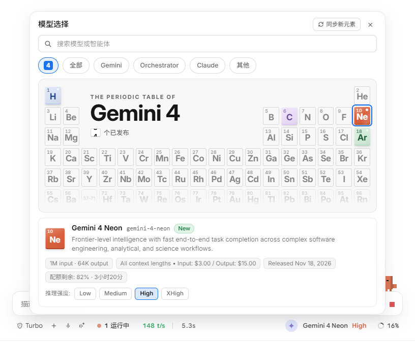

<div align="center">


# Claude Studio

**`agy-claude-studio`** — Native UI Aesthetics Plugin for **Google Antigravity 2.33.1+**

Claude Warm-Gray & Obsidian Palettes · Standalone Glassmorphism · Gemini 4 Periodic Table Selector · 60fps Effort Slider · Pixel Clawd Mascot · Native Aux Pane Studio

<p>
  
  
  
  
  <a href="LICENSE"></a>
</p>

<p>
  <b>English</b> · <a href="README.zh-CN.md">简体中文</a>
</p>

[Preview](#preview) · [Features](#features) · [Quick Install](#quick-install) · [Companion Plugin](#companion-plugin) · [Configuration](#configuration) · [FAQ](#faq) · [Credits](#credits--license)

</div>

---

> **About this project**: `Claude Studio` (`agy-claude-studio`) is an independently evolved community edition based on [0DNANCY/agy-claude-style](https://github.com/0DNANCY/agy-claude-style) `v2.1.0`. It injects non-destructively at runtime via Antigravity's built-in **Chrome DevTools Protocol (CDP)** — **zero host file modification, zero conversation token overhead**, and one-click restore to the native UI at any time.

---

<a id="preview"></a>
## Preview

<div align="center">

#### Gemini 4 Periodic Table Model Selector


<br/>

#### 60fps Effort Slider & Minimalist Composer


<br/>

#### Native "Claude Studio" Aux Pane × "Usage Monitor" Synergy
<table>
  <tr>
    <td align="center" width="50%">
      <br/>
      <sub><b>Claude Studio Control Panel</b>: 4 collapsible setting groups + quick jump to Usage Monitor</sub>
    </td>
    <td align="center" width="50%">
      <br/>
      <sub><b>Usage Monitor Companion</b>: auto-expands per conversation with smart composer footer splitting</sub>
    </td>
  </tr>
</table>

</div>

---

<a id="features"></a>
## Features

| Module | Highlights |
| --- | --- |
| **Themes & Materials** | Three adaptive light/dark solid palettes — `claude` (warm gray/charcoal, default), `obsidian`, and `host` (native) — plus an independent `glassEffect` toggle for frosted popover highlights, floating image viewer pills, and soft composer focus glow. |
| **Model & Reasoning UX** | **Gemini 4 Periodic Table Drawer**: category tabs, live search, quota & reasoning tier switcher, and AI Studio element-sync prompt generator; **60fps Effort Slider**: ChatGPT Codex nebula & Claude Code dot-matrix styles, fully compatible with Antigravity `2.33.1` `· 1M` / `(High Thinking)` badges. |
| **Workspace & Typography** | Compact Claude-style composer & sidebar, CJK IME-friendly smooth interpolated caret, Studio home dashboard (26-week heatmap, 30d/7d stacked bar chart, book-length yardstick), and interactive ASCII wave ripple canvas. |
| **Native Plugin & i18n** | Zero-tool MCP lifecycle host (`tools/list -> []`, **0 token overhead**) with PID-reuse deadlock protection and `<2KB` lightweight config hot-reload; visual right-side Aux Pane; 5-language live UI translation (Simplified Chinese / Traditional Chinese / Cantonese / English / Japanese) across both the main window and **Swarm sidecar (`/swarm`)**, automatically skipping code editors and third-party plugin nodes. |
| **Pixel Mascot Clawd** | 19-state dual-layer pixel companion perched on the composer corner that reacts to thinking/typing/building/compacting/sleeping states, supports poking, rapid-click tickling, dragging, and auto-dodges takeover cards. |

---

<a id="companion-plugin"></a>
## Companion Plugin: `antigravity-usage-monitor`

`Claude Studio` focuses on **visual aesthetics, interaction craft, and localization**. For live token throughput (`tok/s`), TTFT latency, cost estimates, and multi-model quota pools, we recommend pairing it with the independent plugin **[yuhuan-dev/antigravity-usage-monitor](https://github.com/yuhuan-dev/antigravity-usage-monitor)**:

- **Zero-conflict coexistence**: Built-in lightweight usage stats default to off (`usageStatsEnabled: false`), and the i18n engine permanently skips `#ag-usage-monitor-*` roots.
- **Smart footer splitting**: When `usage-monitor` is docked in the composer footer, its context progress ring is seamlessly mirrored to the far right without layout jitter or crowding.
- **Aux Pane synergy**: Once `usage-monitor` is detected, the top "Usage Monitor" shortcut activates automatically, with optional once-per-conversation auto-pinning (`pinUsageMonitorPane: true`) that never steals focus.
- **Clean license boundary**: This project is **MIT**-licensed while `antigravity-usage-monitor` is **GPLv3**-licensed — strictly decoupled and installed independently. If you prefer not to install a companion plugin, you can toggle the built-in lightweight usage HUD at the bottom of the Studio panel anytime.

---

<a id="quick-install"></a>
## Quick Install

### Requirements
- **Google Antigravity Desktop `2.33.1+`** (Windows / macOS) launched with `--remote-debugging-port=0`.
- **Node.js `>= 22`** (zero third-party npm dependencies; uses native `fetch`, `WebSocket`, and `node:test`).

### Fastest Way: Ask Gemini in Antigravity (Recommended)

No terminal needed — just paste this repository URL into any Antigravity chat and say:

> **Help me install this Antigravity plugin: `https://github.com/eosglyph/agy-claude-studio`**

The agent will clone it into your plugins directory, check CDP launch settings, and walk you through enabling it.

> **Optional · Full Dual-Pane Setup**: Want the exact dual-pane experience shown in the screenshots? Ask Gemini to install the standalone companion plugin (GPLv3) together:
>
> **Help me install `https://github.com/eosglyph/agy-claude-studio` along with the companion plugin `https://github.com/yuhuan-dev/antigravity-usage-monitor`**

### Option 1: Antigravity Native Plugin (Manual)

1. Clone this repository into your Antigravity plugins directory:
   ```powershell
   # Windows (PowerShell)
   git clone https://github.com/eosglyph/agy-claude-studio.git "$env:USERPROFILE\.gemini\config\plugins\agy-claude-studio"
   ```
   ```bash
   # macOS / Linux
   git clone https://github.com/eosglyph/agy-claude-studio.git "$HOME/.gemini/config/plugins/agy-claude-studio"
   ```
2. Fully quit Antigravity (including the system tray icon) and relaunch with `--remote-debugging-port=0` (or run `launch.bat` / `./launch.sh` from the repo).
3. Verify **`Claude Studio`** is enabled under **Customizations → Plugins** — it auto-injects and adds the **Claude Studio** panel to your right Aux Pane.
   > Migrating from legacy `agy-claude-style`? On first launch, your existing `plugin_data/agy-claude-style/config.json` is automatically migrated. Disable or remove the legacy plugin folder to avoid duplicate watchers.

<details>
<summary><b>Option 2: Standalone Windows / macOS Installers (No Node.js Required) & Companion Launcher</b></summary>

- **Pre-built Releases**: Grab `Claude-Studio-v<version>-Windows-x64.exe` or `Claude-Studio-v<version>-macOS-universal.dmg` directly from [GitHub Releases](https://github.com/eosglyph/agy-claude-studio/releases).

- **Build Windows standalone installer locally**:
  ```bash
  npm run build:installer
  ```
  Produces a single-file `Claude-Studio-v<version>-Windows-x64.exe` with native C# watcher (`agy-claude-studio-watcher.exe`), supporting both **Managed Mode (0 background processes after host closes)** and **Autostart Daemon Mode**, plus standard uninstall via Windows Settings → Apps.

- **Windows companion launcher pack (with custom Gemini × Clawd icon)**:
  ```powershell
  npm run build:release
  powershell -NoProfile -ExecutionPolicy Bypass -File .\companion\setup-companion.ps1
  ```
  Automatically yields to the native plugin when installed and simply launches Antigravity with `--remote-debugging-port=0` and the custom icon.

- **Build macOS Universal `.app` / `.dmg` locally**:
  ```bash
  npm run build:macos
  ```
  Produces a Universal (`arm64` + `x86_64`) `Claude Studio.app` and `Claude-Studio-v<version>-macOS-universal.dmg`. On first launch, right-click → **Open** or run `xattr -cr "/Applications/Claude Studio.app"` if Gatekeeper prompts for ad-hoc signed binaries.

</details>

<details>
<summary><b>Option 3: Node.js CLI / Local Development</b></summary>

```bash
cp config.example.json config.json   # Optional; built-in defaults work out of the box
npm run inject                        # One-shot injection into current windows
npm run watch                         # Hot-reload watcher (auto-applies code/config edits)
npm run remove                        # Stop watcher and restore native UI cleanly
```

</details>

---

## Meet Clawd

<div align="center">
  
</div>

| Interaction | Gesture | Reaction |
| --- | --- | --- |
| Poke | Click left or right side | Shy head turn (`poke-left` / `poke-right`) |
| Tickle | 4 rapid clicks within `450ms` | Laughing leg-kick (`tickle`) |
| Pick up | Click & drag | Dangling wiggle, drops softly on release (`drag`) |
| Nap | Idle for 60s+ | Falls asleep (`sleeping`), stretches awake on click or new message (`waking`) |
| Live state | Thinking / typing / error / done | Mirrors agent activity and automatically dodges Q&A cards and queue bars |

---

<a id="configuration"></a>
## Configuration

All settings can be toggled live in the right-side **Claude Studio** panel and persist automatically (full schema in [config.example.json](config.example.json)).

<details>
<summary><b>View all configuration keys</b></summary>

| Group | Key | Values / Type | Default | Description |
| --- | --- | --- | --- | --- |
| Basic | `language` | `'zh-CN'` \| `'zh-TW'` \| `'yue'` \| `'en'` \| `'ja'` | `'zh-CN'` | UI & Studio panel language |
| Basic | `homeLayout` | `'studio'` \| `'classic'` \| `'off'` | `'studio'` | New conversation home screen layout |
| Basic | `palette` | `'claude'` \| `'obsidian'` \| `'host'` | `'claude'` | Solid color theme palette |
| UI Polish | `glassEffect` | `boolean` | `true` | Frosted glassmorphism borders, image viewer pills & focus glow |
| UI Polish | `sidebarRestyle` / `sidebarCompact` | `boolean` | `true` | Claude-style sidebar density & hover polish |
| UI Polish | `composerRestyle` / `placeholderStyle` | `boolean` / `'studio'` \| `'host'` | `true` / `'studio'` | Minimalist composer & prompt placeholder copy |
| UI Polish | `logoInk` | `'accent'` \| `'foreground'` | `'accent'` | Home logo tint mode |
| Interaction | `periodicSelector` | `boolean` | `true` | Gemini 4 Periodic Table model selector |
| Interaction | `effortSliderStyle` / `effortAccent` | `'chatgpt'` \| `'claude'` / `boolean` | `'chatgpt'` / `true` | 60fps effort slider style & color scale |
| Interaction | `smoothCaret` / `mascot` / `homeRipple` | `boolean` / `'crab'` \| `'off'` / `boolean` | `true` / `'crab'` / `true` | Smooth caret, Clawd mascot & home ripple field |
| Usage HUD | `pinUsageMonitorPane` | `boolean` | `true` | Auto-open `usage-monitor` pane once per conversation |
| Usage HUD | `usageStatsEnabled` | `boolean` | `false` | Master toggle for built-in HUD (preserves child prefs when off) |
| Usage HUD | `inlineStats` / `ringMode` / `turnBadges` | `boolean` / `'context'` \| `'quota'` / `boolean` | `true` / `'context'` / `true` | *(Requires `usageStatsEnabled`)* Inline stats, context/quota ring & turn `#T` badges |
| Usage HUD | `hudTopBar` / `hudBottomBar` / `hudRimProgress` / `hudFooterChip` / `hudCompact` | `boolean` | `true` | *(Requires `usageStatsEnabled`)* Rim progress bar & compact HUD layout |
| Runtime | `autoRelaunchWithCdp` / `exitOnHostClose` / `pollIntervalMs` | `boolean` / `boolean` / `number` | `true` / `false` / `2500` | CDP relaunch behavior, host-exit lifecycle & polling interval |

</details>

---

<a id="faq"></a>
## FAQ

<details>
<summary><b>1. Not auto-injecting after updating to Antigravity 2.33.0+?</b></summary>

Starting in `2.33.0`, Antigravity disables the CDP port by default. Fully quit Antigravity (including the system tray) and launch it with `--remote-debugging-port=0`, or use the one-click relaunch button in the Studio panel / `launch.bat` / `./launch.sh`.

</details>

<details>
<summary><b>2. Why is the top "Usage Monitor" button disabled?</b></summary>

That shortcut opens the independent companion plugin [yuhuan-dev/antigravity-usage-monitor](https://github.com/yuhuan-dev/antigravity-usage-monitor). Once installed, click "Refresh Status" in the panel to activate it — or simply enable **Built-in Usage Stats** at the bottom of the Studio panel.

</details>

<details>
<summary><b>3. Why are sidebar right-click context menus still in English?</b></summary>

Native context menus are rendered by Electron via OS APIs (Win32 / NSMenu) outside the web DOM, so non-destructive CDP injection cannot rewrite OS menu strings. All in-app DOM views, settings, dialogs, and the Swarm sidecar support full 5-language localization.

</details>

<details>
<summary><b>4. How do I completely restore the native Antigravity UI?</b></summary>

Click **Restore Native** at the top of the **Claude Studio** panel, disable `Claude Studio` in Antigravity Plugins, or run `npm run remove`. Zero host files are ever modified.

</details>

---

## Development & Testing

```bash
npm test                 # Run full unit & integration test suite (Node.js >= 22, zero deps)
npm run build:installer  # Build Windows single-file x64 installer
npm run build:release    # Build Windows companion launcher release pack
npm run build:macos      # Build macOS Universal .app & .dmg (macOS only)
```

<details>
<summary><b>Project Structure</b></summary>

```text
agy-claude-studio/
├── plugin.json / mcp_config.json  # Native Antigravity plugin manifest & zero-tool MCP host config
├── plugin/mcp-host.js             # Native lifecycle host (PID-reuse verification & hot takeover)
├── sidecars/studio/               # Right Aux Pane "Claude Studio" visual control panel
├── cdp.js / lifecycle.js          # CDP client, config migration, lockfile & host watchdog
├── watcher-core.js / inject.js    # Multi-window hot-reload controller & CLI entry
├── style.css / ui-runtime.js      # Core theme styles & UI runtime (home, periodic, slider, synergy)
├── sidecar-core.js                # Lightweight reversible i18n runtime for Swarm sidecar (/swarm)
├── periodic-core.js               # Gemini 4 Periodic Table catalog & filter engine
├── effort-core.js                 # Dual-style 60fps reasoning effort slider model
├── i18n-core.js / i18n-locales.js # 5-language DOM localization engine & dictionaries
├── usage-core.js                  # Built-in trajectory parser, token breakdown & heatmap engine
├── mascot-core.js / crab-assets.js# Clawd state machine & 19 dual-layer pixel sprite sets
├── ripple-core.js                 # Home ASCII noise field & 2D wave solver
├── installer/ & companion/        # Windows (C#) / macOS (Swift) installers & companion scripts
├── scripts/ & test/               # Build pipelines & node:test automated test suite
└── assets/                        # Icons, animated banners & UI screenshots
```

</details>

---

<a id="credits--license"></a>
## Credits & License

Released under the [MIT License](LICENSE). Heartfelt thanks to the upstream authors and community contributors:

- **Upstream Repository**: [0DNANCY/agy-claude-style](https://github.com/0DNANCY/agy-claude-style) (MIT License)
- **Original Inspiration & Early Source**: [Nwflower/dsh-claude-style](https://github.com/Nwflower/dsh-claude-style)
- **macOS Daemon Memory Pool & CDP Connection Reuse**: [SeredenFei/agy-claude-style](https://github.com/SeredenFei/agy-claude-style)
- **Native Plugin Hosting, Aux Pane & 2.33.1 Compat**: [Gruu6y/agy-claude-style](https://github.com/Gruu6y/agy-claude-style)
- **Glassmorphism & Floating Image Viewer Inspiration**: [MCRYII/antigravity-custom-themes](https://github.com/MCRYII/antigravity-custom-themes)
- **Codex Effort Slider Visual Design**: [Microqian2th/dsh-codex-effort-slider](https://github.com/Microqian2th/dsh-codex-effort-slider)
- **Recommended Companion Usage Monitor (GPLv3, standalone)**: [yuhuan-dev/antigravity-usage-monitor](https://github.com/yuhuan-dev/antigravity-usage-monitor)
