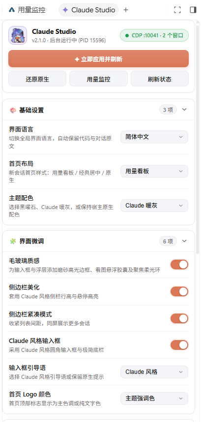
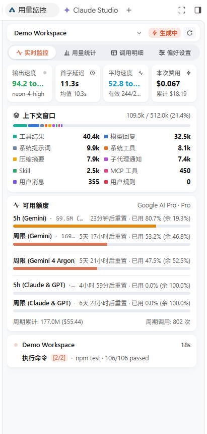

<div align="center">


# Claude Studio

**`agy-claude-studio`** — 面向 **Google Antigravity 2.33.1+** 的原生界面美学插件

Claude 暖灰与黑曜石纯色配色 · 独立毛玻璃质感 · Gemini 4 元素周期表选择器 · 60fps 思考强度滑块 · 像素螃蟹 Clawd · 右侧原生控制室

<p>
  
  
  
  
  <a href="LICENSE"></a>
</p>

[预览](#预览) · [特性](#核心特性) · [快速安装](#快速安装) · [推荐搭档](#推荐搭档) · [配置参考](#配置参考) · [常见问题](#常见问题) · [致谢](#致谢与开源协议)

</div>

---

> **关于本项目**：`Claude Studio` (`agy-claude-studio`) 是基于 [0DNANCY/agy-claude-style](https://github.com/0DNANCY/agy-claude-style) `v2.1.0` 独立演进的社区定制版，通过 Antigravity 内置 **Chrome DevTools Protocol (CDP)** 无损动态注入——**不修改宿主安装文件、不占用对话上下文 Token**，随时可一键还原原生界面。

---

<a id="预览"></a>
## 预览

<div align="center">

#### Gemini 4 元素周期表模型选择器


<br/>

#### 60fps 思考强度滑块 & 极简输入框


<br/>

#### 右侧「Claude Studio」控制室 ×「用量监控」双栏协同
<table>
  <tr>
    <td align="center" width="50%">
      <br/>
      <sub><b>Claude Studio 控制面板</b>：4 组可折叠配置 + 顶部一键跳转用量监控</sub>
    </td>
    <td align="center" width="50%">
      <br/>
      <sub><b>Usage Monitor 搭档面板</b>：切会话自动展开，底栏胶囊智能拆分不遮挡</sub>
    </td>
  </tr>
</table>

</div>

---

<a id="核心特性"></a>
## 核心特性

| 模块 | 能力一览 |
| --- | --- |
| **主题与材质** | 内置 `claude`（暖灰炭黑，默认）/ `obsidian`（黑曜石）/ `host`（宿主原生）三套深浅自适应纯色配色；独立 `glassEffect` 毛玻璃开关（浮层磨砂高光、看图悬浮胶囊、输入框聚焦柔光）。 |
| **模型与推理交互** | **Gemini 4 元素周期表抽屉**：分类筛选、实时搜索、配额与档位直切、AI Studio 新元素同步提示词；**60fps 思考强度滑块**：支持 ChatGPT Codex 星云与 Claude Code 点阵双风格，完整适配 `2.33.1` `· 1M` / `(High Thinking)` 标签。 |
| **工作台与排版** | Claude 风格紧凑输入框与侧边栏、兼容中文 IME 的丝滑插值光标、Studio 首页统计看板（热力图、30d/7d 堆叠图、书籍折算标尺）与可交互字符水波纹背景。 |
| **原生插件与本地化** | 零工具 MCP 生命周期托管（`tools/list -> []`，**0 Token 占用**），具备 PID 复用防死锁保护与 `<2KB` 轻量配置热更新；右侧 Aux Pane 可视化控制室；覆盖主窗口与 **Swarm 蜂群侧栏（`/swarm`）** 的 5 语言热切（简中 / 繁中 / 粤语 / English / 日本語），自动避让代码区与第三方插件节点。 |
| **像素螃蟹 Clawd** | 蹲守输入框右上角的 19 态双层像素小跟班，随会话状态切换思考/打字/构建/压缩/小憩，支持轻戳、连点挠痒、拖拽与自动避让排队卡片。 |

---

<a id="推荐搭档"></a>
## 推荐搭档：`antigravity-usage-monitor`

`Claude Studio` 专注**视觉美学、交互效率与本地化**；实时速率（`tok/s`）、首字延迟、费用估算与多模型额度池推荐搭配独立插件 **[yuhuan-dev/antigravity-usage-monitor](https://github.com/yuhuan-dev/antigravity-usage-monitor)** 使用：

- **零冲突共存**：内置轻量用量统计默认关闭（`usageStatsEnabled: false`），翻译引擎永久避让 `#ag-usage-monitor-*`。
- **底栏智能拆分**：当 `usage-monitor` 停靠在输入框底栏时，自动将其上下文进度环镜像至最右侧，避免挤压或抖动。
- **右侧栏联动**：检测到已安装 `usage-monitor` 后，控制室顶部「用量监控」快捷按钮自动激活，并支持切对话自动展开（`pinUsageMonitorPane: true`，每个对话仅拉起一次，绝不抢焦点）。
- **协议边界清晰**：本项目为 MIT 协议，`antigravity-usage-monitor` 为 GPLv3 协议，二者严格解耦、各自独立安装。若未安装外部监控插件，也可在面板底部随时开启本项目自带的轻量用量统计。

---

<a id="快速安装"></a>
## 快速安装

### 环境要求
- **Google Antigravity Desktop `2.33.1+`**（Windows / macOS），启动时需开启 CDP 参数 `--remote-debugging-port=0`。
- **Node.js `>= 22`**（零第三方 npm 依赖，仅使用内置 `fetch`、`WebSocket` 与 `node:test`）。

### 方式一：Antigravity 原生插件模式（推荐）

1. 将仓库克隆到 Antigravity 插件目录：
   ```powershell
   # Windows (PowerShell)
   git clone https://github.com/eosglyph/agy-claude-studio.git "$env:USERPROFILE\.gemini\config\plugins\agy-claude-studio"
   ```
   ```bash
   # macOS / Linux
   git clone https://github.com/eosglyph/agy-claude-studio.git "$HOME/.gemini/config/plugins/agy-claude-studio"
   ```
2. 彻底退出 Antigravity（含系统托盘），以 `--remote-debugging-port=0` 重新启动（或直接运行仓库内的 `launch.bat` / `./launch.sh`）。
3. 在 Antigravity **Customizations → Plugins** 中确认 **`Claude Studio`** 已启用，即可自动注入并在右侧辅助栏打开 **Claude Studio** 控制面板。
   > 若此前安装过旧版 `agy-claude-style`，首次启动时会自动迁移原有 `plugin_data/agy-claude-style/config.json` 配置，建议同步禁用或移除旧版插件目录以避免双守护冲突。

<details>
<summary><b>方式二：Windows / macOS 独立安装器（无需 Node.js）与伴随启动包</b></summary>

- **Windows 独立安装器**：
  ```bash
  npm run build:installer
  ```
  生成单文件 `Claude-Studio-v<version>-Windows-x64.exe`（内置像素螃蟹图标与原生 C# 守护进程 `agy-claude-studio-watcher.exe`），默认部署至 `%LOCALAPPDATA%\agy-claude-studio` 并支持通过 Windows「设置 → 应用」一键卸载还原。

- **Windows 伴随启动包（含 Gemini × Clawd 定制图标）**：
  ```powershell
  npm run build:release
  powershell -NoProfile -ExecutionPolicy Bypass -File .\companion\setup-companion.ps1
  ```
  若本机已启用原生插件，伴随启动脚本会自动退让，仅负责以 `--remote-debugging-port=0` 和定制图标启动 Antigravity。

- **macOS Universal `.app` / `.dmg`**：
  ```bash
  npm run build:macos
  ```
  生成通用架构（`arm64` + `x86_64`）的 `Claude Studio.app` 与 `Claude-Studio-v<version>-macOS-universal.dmg`。首次打开若提示未签名，请右键选择「打开」或执行 `xattr -cr "/Applications/Claude Studio.app"`。

</details>

<details>
<summary><b>方式三：Node.js CLI 尝鲜 / 本地开发模式</b></summary>

```bash
cp config.example.json config.json   # 可选，默认使用内置配置
npm run inject                        # 单次注入当前窗口
npm run watch                         # 后台热更新守护（改代码/配置自动生效）
npm run remove                        # 停止守护并无损还原原生界面
```

</details>

---

## 小螃蟹 Clawd 互动速览

<div align="center">
  
</div>

| 互动 | 操作方式 | 表现 |
| --- | --- | --- |
| 轻戳 | 单击左侧或右侧身体 | 害羞扭头反馈（`poke-left` / `poke-right`） |
| 挠痒 | `450ms` 内连点 4 下 | 爆笑踢腿（`tickle`） |
| 拎起 | 按住鼠标左键拖拽 | 悬空挣扎，松手落地（`drag`） |
| 小憩 | 界面安静 60 秒以上 | 自动打盹（`sleeping`），点击或发消息伸懒腰唤醒（`waking`） |
| 状态跟随 | AI 思考 / 输出 / 报错 / 完成 | 自动切换对应动作，并在问答卡片或排队栏出现时主动避让 |

---

<a id="配置参考"></a>
## 配置参考

所有选项均可在右侧 **Claude Studio** 面板实时调整并自动保存（完整模板见 [config.example.json](config.example.json)）。

<details>
<summary><b>展开查看全部配置项说明</b></summary>

| 分组 | 配置键 | 可选值 / 类型 | 默认值 | 说明 |
| --- | --- | --- | --- | --- |
| 基础设置 | `language` | `'zh-CN'` \| `'zh-TW'` \| `'yue'` \| `'en'` \| `'ja'` | `'zh-CN'` | 界面与控制面板语言 |
| 基础设置 | `homeLayout` | `'studio'` \| `'classic'` \| `'off'` | `'studio'` | 新会话首页布局 |
| 基础设置 | `palette` | `'claude'` \| `'obsidian'` \| `'host'` | `'claude'` | 纯色主题配色 |
| 界面微调 | `glassEffect` | `boolean` | `true` | 独立毛玻璃质感与柔光细节 |
| 界面微调 | `sidebarRestyle` / `sidebarCompact` | `boolean` | `true` | 侧边栏重塑与紧凑间距 |
| 界面微调 | `composerRestyle` / `placeholderStyle` | `boolean` / `'studio'` \| `'host'` | `true` / `'studio'` | 极简输入框与引导文案风格 |
| 界面微调 | `logoInk` | `'accent'` \| `'foreground'` | `'accent'` | 首页 Logo 着色模式 |
| 进阶交互 | `periodicSelector` | `boolean` | `true` | Gemini 4 元素周期表选择器 |
| 进阶交互 | `effortSliderStyle` / `effortAccent` | `'chatgpt'` \| `'claude'` / `boolean` | `'chatgpt'` / `true` | 思考强度滑块风格与色阶 |
| 进阶交互 | `smoothCaret` / `mascot` / `homeRipple` | `boolean` / `'crab'` \| `'off'` / `boolean` | `true` / `'crab'` / `true` | 丝滑光标、Clawd 挂件、首页水波纹 |
| 用量统计 | `pinUsageMonitorPane` | `boolean` | `true` | 切会话自动展开 `usage-monitor` 右侧栏 |
| 用量统计 | `usageStatsEnabled` | `boolean` | `false` | 内置用量统计总开关（关闭时不覆盖子项偏好） |
| 用量统计 | `inlineStats` / `ringMode` / `turnBadges` | `boolean` / `'context'` \| `'quota'` / `boolean` | `true` / `'context'` / `true` | *(总开关开启后生效)* 内置底栏统计、圆环与轮次徽章 |
| 用量统计 | `hudTopBar` / `hudBottomBar` / `hudRimProgress` / `hudFooterChip` / `hudCompact` | `boolean` | `true` | *(总开关开启后生效)* 环绕进度条与紧凑排版 |
| 运行时 | `autoRelaunchWithCdp` / `exitOnHostClose` / `pollIntervalMs` | `boolean` / `boolean` / `number` | `true` / `false` / `2500` | CDP 自动接管、宿主关闭退出与轮询间隔 |

</details>

---

<a id="常见问题"></a>
## 常见问题

<details>
<summary><b>1. 升级到 Antigravity 2.33.0+ 后没有自动注入？</b></summary>

Antigravity 从 `2.33.0` 起默认不再开启 CDP 端口。请彻底退出 Antigravity（含系统托盘）后携带 `--remote-debugging-port=0` 启动，或直接使用右侧面板的一键重启 / `launch.bat` / `./launch.sh`。

</details>

<details>
<summary><b>2. 顶部「用量监控」按钮是灰色的？</b></summary>

该按钮用于一键跳转到独立插件 [yuhuan-dev/antigravity-usage-monitor](https://github.com/yuhuan-dev/antigravity-usage-monitor)。安装该插件后点击面板右上角「刷新状态」即可激活；如果不装额外插件，也可以在面板底部开启 **「开启内置用量统计」**。

</details>

<details>
<summary><b>3. 为什么侧边栏会话列表的右键菜单仍是英文？</b></summary>

侧边栏右键菜单由 Electron 调用操作系统原生菜单（Win32 / NSMenu）绘制，不在网页 DOM 树中，纯无损 CDP 注入无法改写系统原生菜单文案；应用内所有 DOM 界面、设置页与浮窗均已支持 5 语言本地化。

</details>

<details>
<summary><b>4. 如何彻底还原原生界面？</b></summary>

点击右侧 **Claude Studio** 面板顶部的 **「还原原生」**，或在 Antigravity 插件管理中禁用 `Claude Studio` / 运行 `npm run remove`，即可无痕恢复原版。

</details>

---

## 开发与测试

```bash
npm test                 # 运行全部单元测试（Node.js >= 22，零依赖）
npm run build:installer  # 构建 Windows 单文件安装器
npm run build:release    # 打包 Windows 伴随启动发布包
npm run build:macos      # 构建 macOS Universal .app 与 .dmg（需 macOS 环境）
```

<details>
<summary><b>查看项目目录结构</b></summary>

```text
agy-claude-studio/
├── plugin.json / mcp_config.json  # Antigravity 原生插件清单与零工具 MCP 托管配置
├── plugin/mcp-host.js             # 原生插件生命周期宿主（含 PID 复用校验与热接管）
├── sidecars/studio/               # 右侧 Aux Pane「Claude Studio」可视化控制面板
├── cdp.js / lifecycle.js          # CDP 客户端、配置迁移、进程守护与宿主看门狗
├── watcher-core.js / inject.js    # 多窗口热更新控制器与 CLI 注入入口
├── style.css / ui-runtime.js      # 核心主题样式与运行时（首页、周期表、滑块、联动）
├── sidecar-core.js                # Swarm 蜂群侧栏（/swarm）精简无损翻译运行时
├── periodic-core.js               # Gemini 4 元素周期表模型目录与筛选核心
├── effort-core.js                 # 双风格 60fps 思考强度滑块数学模型
├── i18n-core.js / i18n-locales.js # 5 语言 DOM 本地化引擎与词典
├── usage-core.js                  # 内置轨迹解析、Token 拆解与热力图引擎
├── mascot-core.js / crab-assets.js# Clawd 状态机与 19 套像素双层精灵图
├── ripple-core.js                 # 首页字符矩阵噪声与二维水波求解器
├── installer/ & companion/        # Windows (C#) / macOS (Swift) 独立安装器与伴随脚本
├── scripts/ & test/               # 构建打包脚本与 node:test 自动化测试套件
└── assets/                        # 图标、横幅与实景展示图
```

</details>

---

<a id="致谢与开源协议"></a>
## 致谢与开源协议

本项目基于 [MIT License](LICENSE) 开源，衷心感谢以下开源项目与社区贡献者：

- **上游原版仓库**：[0DNANCY/agy-claude-style](https://github.com/0DNANCY/agy-claude-style)（MIT License）
- **核心设计灵感与早期源码**：[Nwflower/dsh-claude-style](https://github.com/Nwflower/dsh-claude-style)
- **macOS 守护内存池与 CDP 连接复用参考**：[SeredenFei/agy-claude-style](https://github.com/SeredenFei/agy-claude-style)
- **原生插件托管、右侧辅助栏与 2.33.1 适配参考**：[Gruu6y/agy-claude-style](https://github.com/Gruu6y/agy-claude-style)
- **毛玻璃与看图悬浮胶囊设计灵感**：[MCRYII/antigravity-custom-themes](https://github.com/MCRYII/antigravity-custom-themes)
- **Codex 思考强度滑杆样式**：[Microqian2th/dsh-codex-effort-slider](https://github.com/Microqian2th/dsh-codex-effort-slider)
- **推荐搭档用量监控插件（GPLv3，独立解耦安装）**：[yuhuan-dev/antigravity-usage-monitor](https://github.com/yuhuan-dev/antigravity-usage-monitor)
