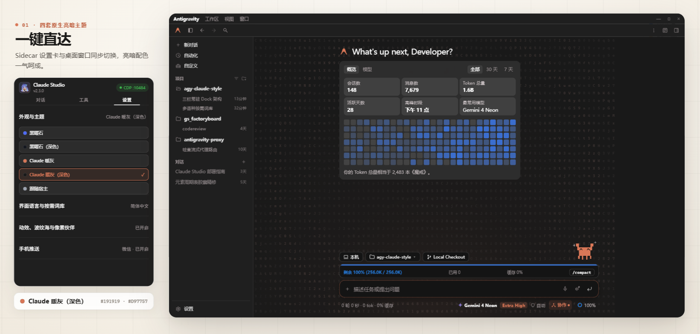
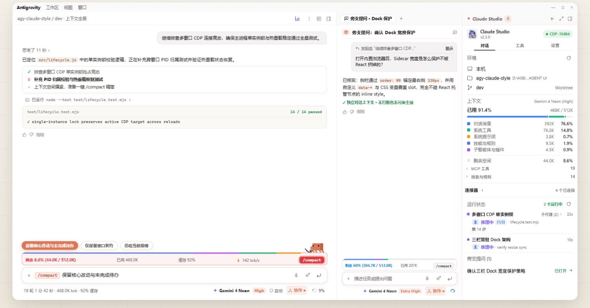
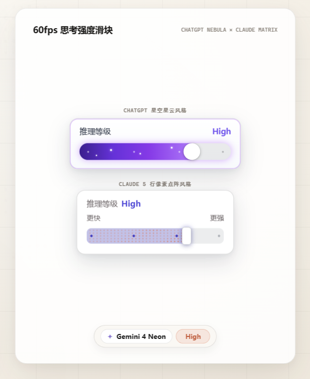
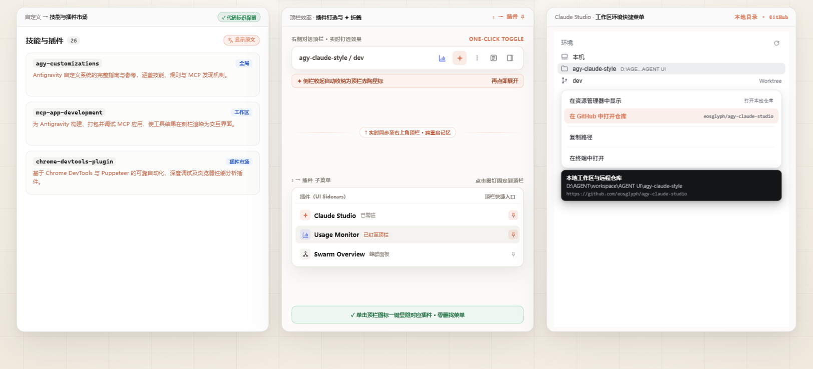
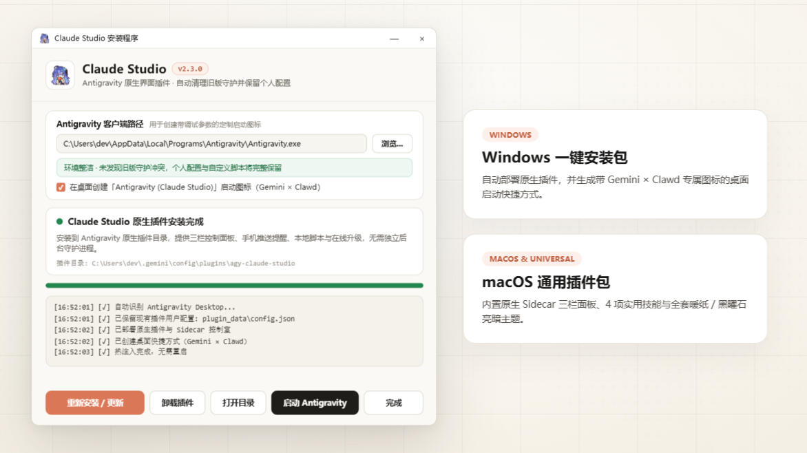

<div align="center">



# Claude Studio

**`agy-claude-studio`** — Native UI Aesthetics & Productivity Plugin for **Google Antigravity 2.33.1+ (v2.36.x Ready)**

5 Explicit Light & Dark Palettes · Persistent 3-Column Dock & Titlebar Plugin Pinning · 3-Tab Studio Sidecar (`Chat | Tools | Settings`) · `/btw` & `/compact` Workflows · Mobile Push Alerts · Gemini 4 Periodic Table · 4 Native Skills · Pixel Clawd Mascot

<p>
  
  
  
  
  <a href="LICENSE"></a>
</p>

<p>
  <b>English</b> · <a href="README.zh-CN.md">简体中文</a>
</p>

[Preview](#preview) · [Features](#features) · [Quick Install](#quick-install) · [Companion Plugin](#companion-plugin) · [Configuration](#configuration) · [FAQ](#faq) · [Credits](#credits--license)

</div>

---

> **About this project**: `Claude Studio` (`agy-claude-studio`) is a community-driven enhancement for Google Antigravity, evolved from [0DNANCY/agy-claude-style](https://github.com/0DNANCY/agy-claude-style). It connects seamlessly at runtime through Antigravity's built-in **Chrome DevTools Protocol (CDP)** — leaving host installation files completely untouched, adding no extra messages or prompt overhead to your conversations, and letting you return to the stock UI with a single click whenever you like.

---

<a id="preview"></a>
## Preview

<div align="center">

#### Full Workspace Overview (Claude Warm Light + Home Usage Heatmap + ASCII Ripple Sea + Persistent Studio v2.3.0 Sidecar + Clawd)


<br/>

#### 5 Symmetric Explicit Light & Dark Palettes (Claude Light/Dark, Obsidian Light/Dark & Follow Host)


<br/>

#### Persistent 3-Column Studio Dock (Far-Right Third Column Alongside Browser, Files & Terminals)


<br/>

#### Context Control: Low-Context Red Alert, `/btw` Side-Questions & `/compact` Presets


<br/>

#### Model Selector & Dual-Style Effort Sliders
<table>
  <tr>
    <td align="center" width="54%">
      <br/>
      <sub><b>Gemini 4 Periodic Table Model Selector</b>: search, category filters, quota badges &amp; direct AI Studio sync</sub>
    </td>
    <td align="center" width="46%">
      <br/>
      <sub><b>Dual-Style 60fps Effort Sliders</b>: ChatGPT Starry Nebula &amp; Claude 5-Row Dot Matrix, plus <code>off</code> to keep native</sub>
    </td>
  </tr>
</table>

<br/>

#### Workflow Efficiency: On-Demand Skills & Marketplace Translate, Titlebar Plugin Pinning (`📌` + `✦`) & Workspace Quick Actions


<br/>

#### Claude Studio Sidecar × Usage Monitor Companion
<table>
  <tr>
    <td align="center" width="50%">
      <br/>
      <sub><b>Claude Studio Sidecar</b>: compact accordion Settings, on-demand locale packs, beta channel &amp; 1-click header upgrade</sub>
    </td>
    <td align="center" width="50%">
      <br/>
      <sub><b>Usage Monitor Companion</b>: coexists cleanly alongside the independent 3-column dock and pins to the titlebar in one click</sub>
    </td>
  </tr>
</table>

</div>

---

<a id="features"></a>
## Features

Here is a quick tour of what Claude Studio adds on top of Antigravity — everything runs in memory over CDP, so your installation files stay untouched and you can switch back to the stock UI anytime.

### Persistent 3-Column Studio Dock & 3-Tab Sidecar (`Chat | Tools | Settings`)
Pin Claude Studio to the far right as an independent third column (`pinRightPane: 'studio' | 'off'`) so it stays visible alongside built-in browser previews, file viewers, terminals, or other Aux Pane tabs without competing for space. It also supports solo dock mode when no Aux Pane is open, yields with zero-frame delay whenever the Aux Pane is maximized (such as full-screen image viewing) and restores cleanly afterward, and collapses down to `0px` into a single terracotta `✦` button in the conversation titlebar when you want full width.
- **Chat**: Features a Claude-style Environment & Git Worktree selector menu (with `.repo + worktree/` container repository detection and a dark branch hover tooltip), connected tools summary, and a billing-aligned context breakdown by category (system prompt, MCP tools, skills, rules, and conversation). At the bottom, live activity tracks active tasks with one-click pinning, streaming previews, subagents, and full `/btw` side-question threads marked with concise `Side` badges.
- **Tools**: A local script runner for Node, Python, and Shell scripts, pre-seeded with an Antigravity official changelog fetcher (`scripts/fetch-agy-changelog.mjs`) with automatic Chinese translation, alongside a mobile push quick panel. Script output opens in a **wide Markdown card right above the chat box** — purely local, never triggering an AI turn — where you can copy, collapse/expand without losing logs, or re-open anytime via the `Wide` button.
- **Settings**: Organized into a compact single-open accordion covering themes, layout, effort slider style, on-demand locale packs, an opt-in Beta update channel (`receivePrerelease`), and HUD options, all persisted automatically. The single-row header includes a 1-click **Upgrade** button that updates in place, automatically cleans up pre-v2.2.4 legacy root files against a SHA-256 allowlist (preserving any user edits and local data), and triggers a clean hot re-injection.

### Titlebar Pinning for Any UI Sidecar Plugin
Keep your favorite sidecar plugins one click away in the conversation header:
- Every row in the `⋮ → Plugins` submenu includes a `📌` pill to pin or unpin any UI sidecar plugin without opening it or closing the menu.
- Pinned plugins appear with their original icons lined up to the left of `⋮` and support **3-state click toggling** (open / switch / close-collapse).
- Automatically deduplicates against the collapsed Claude Studio `✦` button so the titlebar stays uncluttered.

### 5 Explicit Light & Dark Palettes
Choose from five symmetric palettes — **`claude`** (Claude Light), **`claude-dark`** (Claude Dark), **`obsidian`** (Obsidian Light), **`obsidian-dark`** (Obsidian Dark), and **`host`** (Follow Host). Explicit light and dark palettes render consistently regardless of Antigravity's own light or dark theme, covering CSS tokens, code syntax highlighting, usage charts, effort sliders, glassmorphism overlays, and the Studio sidecar panel.

### Model Picker, Reasoning Effort, `/compact` & `/btw`
- **Grouped Model Pill & Gemini 4 Periodic Table**: Combines `✦` and the model name into a unified hover/open pill (suppressing the overlapping native model menu), paired with a separate equal-height reasoning effort pill. The periodic-table grid organizes models by tier and capability with instant search, category filters, quota badges, and direct sync from Google AI Studio.
- **Orchestrator Quick Switch**: Sits right next to the model picker to toggle multi-agent mode in one click, remembers your choice across restarts, and locks while a turn is running so you do not flip it mid-stream.
- **Dual-Style 60fps Effort Slider & Composer Isolation**: Pick between ChatGPT Starry Nebula (`chatgpt`), Claude 5-Row Dot Matrix (`claude`), or `off` to keep Antigravity's native effort control (which narrows the Periodic Table entry to `✦` only). Disabling `composerRestyle` cleanly isolates native composer layout and glass styling.
- **`/compact` Presets & Seamless `/btw` Token Swaps**: Five customizable `/compact` presets — **Empty** (`empty`), **Clean Focus** (`clean`, default), **Dev Handoff** (`dev`), **Continue** (`continue`), and **Custom** (`custom`). Switching between `/compact` and `/btw` replaces existing Lexical slash tokens cleanly in place while preserving normal drafts and active IME composition, without auto-sending.

### Antigravity v2.36.0 Localization & On-Demand Translation
- **Full Antigravity v2.36.0 Coverage**: Covers Side Question, New Tab, Settings, dialogs, and the `/swarm` multi-agent sidecar with a fast DOM observer engine, plus stale cloud pack protection so older remote packs never overwrite newer built-in strings.
- **On-Demand Language Packs**: English (`en`) and Simplified Chinese (`zh-CN`) ship bundled; Traditional Chinese (`zh-TW`), Cantonese (`yue`), and Japanese (`ja`) download on demand with SHA-256 verification, clearly showing `Cloud` vs. `Cloud Updated` status badges in Settings.
- **Marketplace & Skills On-Demand Translate Pills**: Adds on-demand translate pills to both the Plugin Marketplace and `Settings → Skills` / `/customizations`. Zero background network requests are made until you click; translations preserve code identifiers, fall back automatically if a provider rate-limits, toggle cleanly back to the original text, and respect `translate="no"`, `.notranslate`, a cloud protection list, and your custom `i18nIgnoreSelectors`.

### Chat File Link Right-Click Menu
When the assistant links a local file or drops an `@` mention pill in chat, right-click it to:
- **Open File** with your OS default app (restricted to safe document, code, and media file types).
- **Reveal in Folder** — uses `explorer.exe /select` directly on Windows for fast, flicker-free selection (falling back to the native helper only for edge cases like commas in paths) and highlights the file in Finder on macOS.
- **Copy Full Path** straight to your clipboard.

Toggleable anytime via `fileLinkContextMenu` in Settings.

### Mobile Push Notifications
When you kick off a long refactor or batch run and step away from your desk, Claude Studio can notify your phone locally through Antigravity's Stop Hook as soon as the run finishes or encounters an error.
- **8 supported channels**: ServerChan (supports full Markdown up to ~28KB), Bark (iOS), ntfy, Feishu, DingTalk, WeCom, Telegram Bot, and custom Webhooks.
- **Sensible defaults**: Filters out quick turns (default threshold is 3 minutes), alerts immediately on errors, and stays quiet when you cancel a run manually.
- Credentials and webhook URLs stay local in `PLUGIN_DATA/notify.json` — nothing is written to `config.json` or injected into web views.

### Visual Polish, Loading Animation & Clawd
- **Craft & Home Dashboard**: Optional frosted glassmorphism borders, `logoInk` top-left icon tinting, a CJK-friendly smooth typing caret, and a Studio home dashboard featuring a usage heatmap and interactive ASCII wave ripple.
- **Loading Animation (`geminiLoader`)**: Swaps out Antigravity's large stock loading spinners for animated Gemini-chan with a crisp 12-tick overhead ring.
- **Pixel Companion Clawd**: A 19-state pixel crab perched on your composer that reacts to pokes, tickles, drags, and assistant activity (thinking, typing, error, done), and automatically dodges Q&A cards or queue bars.

### 4 Native Skills
Built-in conversational workflows you can invoke right in chat:
- **`studio-setup`**: 30-second guided initial configuration.
- **`studio-doctor`**: Checks CDP connectivity, permissions, and running processes, and fixes common issues.
- **`studio-notify`**: Step-by-step wizard to configure and test mobile push notifications.
- **`studio-translation-protect`**: Helps you add custom CSS selectors to the translation exclusion list.

---

<a id="companion-plugin"></a>
## Companion Plugin: `antigravity-usage-monitor`

`Claude Studio` focuses on **visual aesthetics, interaction craft, live workspace inspection, and localization**. If you also want real-time generation speed (`tok/s`), time-to-first-token (TTFT) latency, cost estimates, and multi-model quota pools, pair it with the independent companion plugin **[yuhuan-dev/antigravity-usage-monitor](https://github.com/yuhuan-dev/antigravity-usage-monitor)**:

- **Independent Side-by-Side Coexistence**: In `v2.3.0`, Claude Studio occupies its own far-right third column (`pinRightPane: 'studio' | 'off'`), so it coexists side-by-side with `Usage Monitor` inside the Aux Pane without competing for the same slot.
- **One-Click Titlebar Pinning**: Open `⋮ → Plugins` in the conversation header and click the `📌` pill next to **Usage Monitor** to pin its original icon to the titlebar for instant 3-state toggling (open / switch / close-collapse) alongside Claude Studio.
- **Zero-Conflict HUD & Localization**: Claude Studio's built-in lightweight HUD defaults to a clean top bar (`usageStatsEnabled: true`, `hudTopBar: true`, `hudBottomBar: false`, `hudRimProgress: false`) and can be toggled off anytime in Settings. The localization engine permanently skips `#ag-usage-monitor-*` elements via `i18n-compat.json`.
- **Smart Footer Splitting**: When `usage-monitor` docks into the composer footer, Claude Studio mirrors its context progress ring cleanly to the far right, eliminating layout collisions or visual clutter.
- **Clean License Boundary**: Claude Studio is licensed under **MIT**, while `antigravity-usage-monitor` is licensed under **GPLv3**. Both plugins are completely decoupled and install independently.

---

<a id="quick-install"></a>
## Quick Install

### Requirements
- **Google Antigravity Desktop `2.33.1+`** (tested through `2.36.x`; Windows / macOS / Linux) launched with `--remote-debugging-port=0`.
- **Node.js `>= 22`** (zero third-party npm dependencies; uses built-in `fetch`, `WebSocket`, and `node:test`).

### Fastest Way: Ask Gemini in Antigravity (Recommended)

No terminal commands needed. Simply paste this repository URL into any Antigravity conversation and ask:

> **Help me install this Antigravity plugin: `https://github.com/eosglyph/agy-claude-studio`**

Once installed, you can ask Gemini to run the built-in setup skills:
- *"Walk me through 30s Claude Studio setup"* (`studio-setup`)
- *"Help me set up mobile push alerts"* (`studio-notify`)
- *"Diagnose Claude Studio"* (`studio-doctor`)

#### Upgrading from an Older Version
If you already have Claude Studio installed and want to upgrade to the latest release, click **Upgrade** in the Claude Studio sidecar header, or paste this prompt into Antigravity:

> **Please follow the Upgrade & Legacy Migration Checklist in README.md and the latest Release Notes at `https://github.com/eosglyph/agy-claude-studio` to upgrade/migrate my local Claude Studio to the latest version.**

*(Note: If you previously gave an upgrade instruction mentioning a specific older release like v2.2.1, this exact same checklist applies to upgrading to the latest version.)*

#### Optional Dual-Pane Setup
To install Claude Studio alongside the independent usage monitor companion in a single step, ask Gemini:

> **Help me install `https://github.com/eosglyph/agy-claude-studio` along with the companion plugin `https://github.com/yuhuan-dev/antigravity-usage-monitor`**

---

### Upgrade & Legacy Migration Checklist

Whether upgrading manually, running the installer, or delegating the upgrade to an AI coding assistant, follow this checklist:

1. **Preserve User Data**:
   All user preferences, webhook credentials, script definitions, and downloaded language packs reside in `~/.gemini/antigravity/plugin_data/agy-claude-studio/` (`config.json`, `notify.json`, `notify-state.json`, `scripts.json`, `i18n-packs/`) and custom operational scripts in `scripts/ops/`. These files must be preserved across updates. First-time launches automatically migrate legacy configurations from `plugin_data/agy-claude-style/config.json`, and in-place upgrades from pre-`v2.2.4` versions automatically clean up retired root-level files via a SHA-256 allowlist while leaving any user-modified files untouched.
2. **Legacy Windows Watcher Migration (`agy-claude-style-watcher.exe`)**:
   - Simply updating plugin files or extracting into a new `agy-claude-studio` directory does **not** stop or replace an older standalone `agy-claude-style-watcher.exe` running from a previous installation directory (such as `%LOCALAPPDATA%\agy-claude-style`).
   - If running the Windows 1-Click Installer (`Claude-Studio-v<version>-Windows-x64.exe`), legacy cleanup and migration are handled completely automatically.
   - If upgrading manually or via an AI coding assistant from `v2.1` / `v2.2` / `agy-claude-style`: perform a read-only check first for any running `agy-claude-style-watcher.exe` process or legacy Startup / Add-or-Remove-Programs entries. Ask the user for confirmation before stopping or uninstalling the legacy watcher. Once the legacy watcher has exited, enable the new native plugin (which cleanly unloads and stops injecting whenever toggled off in Plugins).
3. **Hot-Refresh & Verify**:
   If Antigravity is already running with `--remote-debugging-port=0`, run `npm run inject` (or `node src/inject.js`) from the plugin directory to hot-refresh active windows without restarting. **Never force-kill a running Antigravity process without explicit user confirmation.** After enabling the plugin, run `studio-setup` or `studio-doctor` to confirm everything is operational.

---

### Installation Options

#### Option 1: Windows 1-Click Native Plugin Installer (Recommended for Windows)

<div align="center">
  
</div>

Download `Claude-Studio-v<version>-Windows-x64.exe` from [GitHub Releases](https://github.com/eosglyph/agy-claude-studio/releases) and double-click to run:
- Features a redesigned **Claude warm-ivory** native setup interface with zero external runtime requirements.
- Automatically detects and cleans up legacy `v2.1.0 / v2.2.0 / v2.2.1` standalone watchers, older `agy-claude-style` plugins, and pre-`v2.2.4` legacy root files while preserving all personal configuration files and custom scripts.
- Installs and enables the complete native plugin into `%USERPROFILE%\.gemini\config\plugins\agy-claude-studio`.
- Creates persistent Desktop and Start Menu shortcuts featuring the custom **Gemini × Clawd** icon pointing directly to your local `Antigravity.exe --remote-debugging-port=0`.
- Supports clean uninstallation via Windows Settings → Installed Apps.

#### Option 2: Cross-Platform Universal Plugin ZIP & Manual Clone

Download `Claude-Studio-v<version>-plugin.zip` from [GitHub Releases](https://github.com/eosglyph/agy-claude-studio/releases):
- Extract the archive into `~/.gemini/config/plugins/` (creating `~/.gemini/config/plugins/agy-claude-studio`).
- Fully quit Antigravity (including the system tray icon) and relaunch with `--remote-debugging-port=0` (or run `npm run launch` / `node src/inject.js --launch`).
- Confirm **`Claude Studio`** is enabled under **Customizations → Plugins**.

> **Platform Note**: The maintainer does not currently have access to physical Mac hardware. macOS and Linux users are encouraged to install via the universal `plugin.zip` or by asking Gemini in Antigravity. Real-hardware feedback is warmly welcomed!

<details>
<summary><b>Manual Git Clone, Local Builds & Companion Scripts</b></summary>

- **Manual Git Clone**:
  ```powershell
  # Windows (PowerShell)
  git clone https://github.com/eosglyph/agy-claude-studio.git "$env:USERPROFILE\.gemini\config\plugins\agy-claude-studio"
  ```
  ```bash
  # macOS / Linux
  git clone https://github.com/eosglyph/agy-claude-studio.git "$HOME/.gemini/config/plugins/agy-claude-studio"
  ```

- **Build Windows Native Plugin Installer / Universal Plugin ZIP Locally**:
  ```bash
  npm run build:installer
  # Or build the universal plugin ZIP alongside
  node scripts/build-installer.mjs --plugin-zip dist/Claude-Studio-plugin.zip
  ```

- **Windows Companion Launcher Pack (with Gemini × Clawd Icon)**:
  ```powershell
  npm run build:release
  powershell -NoProfile -ExecutionPolicy Bypass -File .\companion\setup-companion.ps1
  ```
  When the native plugin is already installed, the companion launcher script automatically yields and simply launches Antigravity with `--remote-debugging-port=0` and the custom icon.

- **Build macOS Universal `.app` / `.dmg` Locally**:
  ```bash
  npm run build:macos
  ```
  Produces a universal (`arm64` + `x86_64`) `Claude Studio.app` and `Claude-Studio-v<version>-macOS-universal.dmg`. If macOS Gatekeeper flags an ad-hoc signed binary on first launch, right-click → **Open** or run `xattr -cr "/Applications/Claude Studio.app"`.

</details>

<details>
<summary><b>Option 3: Node.js CLI & Local Development</b></summary>

```bash
cp config.example.json config.json   # Optional; default configuration works out of the box
npm run inject                        # One-shot injection into active windows
npm run watch                         # Live hot-reloading watcher for local development
npm run remove                        # Disconnect and cleanly restore native UI
```

</details>

---

## Meet Clawd

<div align="center">
  
</div>

| Interaction | How to Trigger | What Happens |
| --- | --- | --- |
| Poke | Click on the left or right side of Clawd | Shy head-turn reaction (`poke-left` / `poke-right`) |
| Tickle | 4 rapid clicks within `450ms` | Laughing leg-kick celebration (`tickle`) |
| Pick up | Click & drag across the screen | Dangling wiggle, gently floats down on release (`drag`) |
| Nap | Leave the app idle for 60s+ | Dozes off to sleep (`sleeping`), stretches awake on click or new message (`waking`) |
| Live state | Thinking / typing / error / done | Mirrors your assistant's state in real time and automatically sidesteps Q&A cards and queue bars |

---

<a id="configuration"></a>
## Configuration

All settings can be adjusted in real time from the right-side **Claude Studio** sidecar panel (under the **Settings** tab) and persist automatically across restarts (see [config.example.json](config.example.json) for the complete reference schema). Mobile push notification settings and webhook tokens are stored privately on your local machine in `PLUGIN_DATA/notify.json` and are never written to `config.json` or injected into browser pages.

<details>
<summary><b>View all configuration keys</b></summary>

| Group | Key | Values / Type | Default | Description |
| --- | --- | --- | --- | --- |
| Basic | `language` | `'zh-CN'` \| `'zh-TW'` \| `'yue'` \| `'en'` \| `'ja'` | `'zh-CN'` | UI & Studio panel language (`en` & `zh-CN` bundled; `zh-TW`, `yue`, `ja` downloaded on demand) |
| Basic | `homeLayout` | `'studio'` \| `'classic'` \| `'off'` | `'studio'` | New conversation home screen layout |
| Basic | `palette` | `'claude'` \| `'claude-dark'` \| `'obsidian'` \| `'obsidian-dark'` \| `'host'` | `'claude'` | Explicit light/dark color theme palette, or `'host'` to follow Antigravity native appearance |
| UI Polish | `glassEffect` | `boolean` | `true` | Frosted glassmorphism borders, floating image viewer pills & ambient glow |
| UI Polish | `sidebarRestyle` / `sidebarCompact` | `boolean` | `true` | Claude-style sidebar density & hover polish |
| UI Polish | `composerRestyle` / `placeholderStyle` | `boolean` / `'studio'` \| `'host'` | `true` / `'studio'` | Minimalist composer (`false` keeps native layout isolated) & prompt placeholder copy |
| UI Polish | `logoInk` | `'accent'` \| `'foreground'` | `'accent'` | Home & top-left app logo tint mode |
| UI Polish | `geminiLoader` | `boolean` | `true` | Swap default large loading spinner for Gemini-chan animation & 12-tick ring |
| Interaction | `periodicSelector` / `orchestratorSwitch` | `boolean` | `true` | Gemini 4 Periodic Table selector & Orchestrator quick switch |
| Interaction | `effortSliderStyle` / `effortAccent` | `'chatgpt'` \| `'claude'` \| `'off'` / `boolean` | `'chatgpt'` / `true` | 60fps effort slider style (`'off'` keeps native effort control) & color scale |
| Interaction | `compactPreset` / `compactCustomText` | `'empty'` \| `'clean'` \| `'dev'` \| `'continue'` \| `'custom'` / `string` | `'clean'` / `''` | `/compact` preset & custom prompt text |
| Interaction | `fileLinkContextMenu` | `boolean` | `true` | Right-click chat file links & mentions to Open File, Reveal in Folder, or Copy Full Path |
| Interaction | `smoothCaret` / `mascot` / `homeRipple` | `boolean` / `'crab'` \| `'off'` / `boolean` | `true` / `'crab'` / `true` | Smooth caret, Clawd mascot & home ripple field |
| Localization | `pluginPageTranslate` / `i18nIgnoreSelectors` | `boolean` / `string[]` | `true` / `[]` | Marketplace & Skills on-demand translate pills & custom protected CSS selectors |
| Dock & Toolbar | `pinRightPane` | `'studio'` \| `'off'` | `'studio'` | Pin Claude Studio as an independent persistent far-right 3rd column |
| Dock & Toolbar | `pinnedToolbarPlugins` | `string[]` | `[]` | UI sidecar plugin IDs pinned to the conversation titlebar via `⋮ → Plugins` `📌` |
| Usage HUD | `usageStatsEnabled` | `boolean` | `true` | Master toggle for built-in HUD (preserves child preferences when turned off) |
| Usage HUD | `inlineStats` / `ringMode` / `turnBadges` | `boolean` / `'context'` \| `'quota'` / `boolean` | `true` / `'context'` / `true` | *(Requires `usageStatsEnabled`)* Inline stats, context/quota ring & turn `#T` badges |
| Usage HUD | `hudTopBar` / `hudBottomBar` / `hudRimProgress` | `boolean` | `true` / `false` / `false` | *(Requires `usageStatsEnabled`)* Top HUD bar, bottom bar & rim progress bar |
| Updates & Runtime | `receivePrerelease` | `boolean` | `false` | Opt in to beta / prerelease update notifications in the Studio header |
| Updates & Runtime | `autoRelaunchWithCdp` / `exitOnHostClose` / `pollIntervalMs` | `boolean` / `boolean` / `number` | `true` / `false` / `2500` | CDP relaunch behavior, host-exit lifecycle & polling interval (`configSchemaVersion: 2`) |

</details>

---

<a id="faq"></a>
## FAQ

<details>
<summary><b>1. Not injecting automatically after updating to Antigravity 2.33.0+?</b></summary>

Starting in `2.33.0`, Antigravity disables the CDP remote debugging port by default. Fully quit Antigravity (including the background system tray icon) and relaunch it with `--remote-debugging-port=0`, or use the one-click relaunch button in the Studio panel / `npm run launch` (`node src/inject.js --launch`). You can also ask Gemini *"Diagnose Claude Studio"* to trigger the `studio-doctor` skill for automated troubleshooting.

</details>

<details>
<summary><b>2. How do I use `Usage Monitor` alongside Claude Studio now?</b></summary>

Starting in `v2.3.0`, Claude Studio runs in its own **independent far-right 3rd column** (`pinRightPane: 'studio' | 'off'`), so it no longer competes with `Usage Monitor` for the Aux Pane slot — both panels can stay open side-by-side cleanly. For quick one-click toggling, open `⋮ → Plugins` in the conversation titlebar and click the `📌` pill next to **Usage Monitor** to pin its icon directly left of `⋮` (supporting 3-state open / switch / close-collapse).

</details>

<details>
<summary><b>3. Why are sidebar right-click context menus still in English?</b></summary>

Sidebar item context menus are rendered directly by Electron via operating system APIs (Win32 / NSMenu) outside the browser DOM. Non-destructive CDP injection operates purely within the web environment and cannot modify OS-level menus. All application DOM views, settings pages, dialogs, and the Swarm sidecar support full 5-language localization.

</details>

<details>
<summary><b>4. How do I completely restore the native Antigravity UI?</b></summary>

Click **Restore Native** in the **Claude Studio** panel, toggle `Claude Studio` off in Antigravity Plugins, or run `npm run remove`. No host files are ever modified, and the stock UI is restored immediately.

</details>

<details>
<summary><b>5. Windows Non-TUN / Process-Level Proxy Setup Tips</b></summary>

If you run Windows without TUN mode or a system-wide proxy and instead inject process-level proxy variables via a launcher script when starting Antigravity:

1. **Initial Launch Shortcut**: Point your `Antigravity (Claude Studio).lnk` shortcut to your process-level proxy launcher (make sure it forwards `%*` arguments) and include `--remote-debugging-port=0` in the shortcut arguments.
2. **Recommended Environment Variables** (using local proxy `127.0.0.1:7890` as an example):
   ```bat
   set HTTP_PROXY=http://127.0.0.1:7890
   set HTTPS_PROXY=http://127.0.0.1:7890
   set NODE_USE_ENV_PROXY=1
   set NO_PROXY=localhost,127.0.0.1,::1
   ```
   - `NODE_USE_ENV_PROXY=1` enables Node.js 22+ built-in `fetch` to honor proxy variables, allowing sidecar **self-update checks**, **Gemini 4 Periodic Table sync**, and **on-demand language pack downloads** to route through your proxy;
   - `NO_PROXY=localhost,127.0.0.1,::1` keeps local CDP debugging and `language_server` loopback traffic direct;
   - You can also set `ALL_PROXY` if your environment uses SOCKS5.
3. **Automatic Proxy Retention on Sidecar Relaunch**: When relaunching Antigravity from the right-side **Claude Studio** panel, the plugin automatically forwards `HTTP_PROXY`, `HTTPS_PROXY`, `ALL_PROXY`, `NO_PROXY`, and `NODE_USE_ENV_PROXY` into the relaunched `Antigravity.exe` process and cleans up the temporary relaunch script upon completion or failure. Users on TUN mode or direct connections experience zero behavior change.

</details>

---

## Development & Testing

```bash
npm test                 # Run automated test suite (Node.js >= 22, zero dependencies)
npm run build:installer  # Build Windows single-file x64 installer
npm run build:release    # Build Windows companion launcher release pack
npm run build:macos      # Build macOS Universal .app & .dmg (requires macOS environment)
```

<details>
<summary><b>Project Structure</b></summary>

```text
agy-claude-studio/
├── plugin.json / mcp_config.json / hooks.json  # Native plugin manifest, MCP host & Stop hook
├── plugin/mcp-host.js                          # Native lifecycle host (PID reuse check & hot takeover)
├── sidecars/studio/                            # 3-Tab persistent Studio dock (Chat | Tools | Settings)
├── skills/                                     # 4 native skills (setup, doctor, notify, translation-protect)
├── src/                                        # Core runtime, CDP lifecycle, UI modules & localization engine
│   ├── cdp.js / lifecycle.js                   # CDP client, config migration, process guard & host watchdog
│   ├── watcher-core.js / inject.js / remove.js # Multi-window hot-reload controller & CLI inject/remove entries
│   ├── style.css / ui-runtime.js               # Core theme styles & UI runtime (home, dock, periodic table, slider, /compact)
│   ├── sidecar-core.js                         # Lightweight reversible translation runtime for Swarm sidecar (/swarm)
│   ├── periodic-core.js / periodic-sync.js     # Gemini 4 Periodic Table catalog & direct AI Studio sync
│   ├── effort-core.js                          # Dual-style 60fps reasoning effort slider math model
│   ├── notify-core.js / scripts-core.js        # 8-channel mobile push engine & local scripts toolbox
│   ├── i18n-core.js / i18n-locales.js / i18n-sync.js # 5-language localization engine, locale pack loader & sync pipeline
│   ├── usage-core.js                           # Built-in trajectory parser, token breakdown & heatmap engine
│   ├── mascot-core.js / crab-assets.js         # Clawd state machine & 19 dual-layer pixel sprite sets
│   └── ripple-core.js                          # Home ASCII noise field & 2D wave solver
├── locales/                                    # Bundled and on-demand language pack dictionaries
├── i18n-compat.json                            # Built-in translation protection rules for companion plugins
├── installer/ & companion/                     # Windows (C#) / macOS (Swift) installers & companion scripts
├── scripts/                                    # Stop hook, changelog fetcher, Windows helper & build pipelines
│   ├── notify-stop.mjs / fetch-agy-changelog.mjs # Stop hook runner & Antigravity changelog fetcher (auto-CN)
│   ├── WindowsFileAction.cs                    # Native Windows file action helper (flicker-free Explorer selection & open)
│   └── build-*.mjs                             # Installer, macOS, locale-pack & release build scripts
├── test/                                       # node:test automated test suite
└── assets/                                     # Icons, animated banners & UI screenshots
```

</details>

---

<a id="credits--license"></a>
## Credits & License

Released under the [MIT License](LICENSE). Heartfelt thanks to the upstream authors and community contributors:

- **Upstream Repository**: [0DNANCY/agy-claude-style](https://github.com/0DNANCY/agy-claude-style) (MIT License)
- **Original Inspiration & Early Source**: [Nwflower/dsh-claude-style](https://github.com/Nwflower/dsh-claude-style)
- **macOS Daemon Memory Pool & CDP Connection Reuse**: [SeredenFei/agy-claude-style](https://github.com/SeredenFei/agy-claude-style)
- **Native Plugin Hosting, Aux Pane & 2.33.1 Compat**: [Gruu6y/agy-claude-style](https://github.com/Gruu6y/agy-claude-style)
- **Glassmorphism & Floating Image Viewer Inspiration**: [MCRYII/antigravity-custom-themes](https://github.com/MCRYII/antigravity-custom-themes)
- **Codex Effort Slider Visual Design**: [Microqian2th/dsh-codex-effort-slider](https://github.com/Microqian2th/dsh-codex-effort-slider)
- **Recommended Companion Usage Monitor (GPLv3, standalone)**: [yuhuan-dev/antigravity-usage-monitor](https://github.com/yuhuan-dev/antigravity-usage-monitor)
