<div align="center">


# Claude Studio

**`agy-claude-studio`** — 给 **Google Antigravity 2.33.1+（全面适配 v2.36.x）** 换上一套顺手、好看的界面与效率小工具

5 套对称亮暗配色 · 独立三栏常驻侧栏与顶栏插件钉选 · 3-Tab 控制室（对话 / 工具 / 设置） · `/btw` 旁支与 `/compact` 预设 · 长任务手机推送 · Gemini 4 元素周期表 · 4 项内置技能 · 像素小螃蟹 Clawd

<p>
  
  
  
  
  <a href="LICENSE"></a>
</p>

<p>
  <a href="README.md">English</a> · <b>简体中文</b>
</p>

[预览](#预览) · [特性](#核心特性) · [快速安装](#快速安装) · [推荐搭档](#推荐搭档) · [配置参考](#配置参考) · [常见问题](#常见问题) · [致谢](#致谢与开源协议)

</div>

---

> **关于本项目**：`Claude Studio` (`agy-claude-studio`) 是基于 [0DNANCY/agy-claude-style](https://github.com/0DNANCY/agy-claude-style) `v2.1.0` 独立演进的社区定制版，通过 Antigravity 内置 **Chrome DevTools Protocol (CDP)** 无损动态注入——**不修改宿主安装文件、不向模型发送额外上下文**，随时可一键还原原生界面。

---

<a id="预览"></a>
## 预览

<div align="center">

#### 全局工作区总览（Claude 暖灰配色 + 首页用量热力图 + 字符波纹海 + 常驻 Claude Studio 控制室 + Clawd）
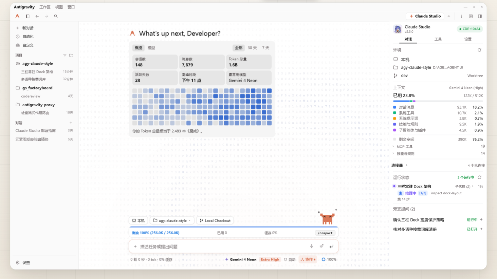

<br/>

#### 5 套对称显式浅色 / 深色配色一键切换（Claude 暖灰 / 黑曜石 亮暗 + 跟随宿主）
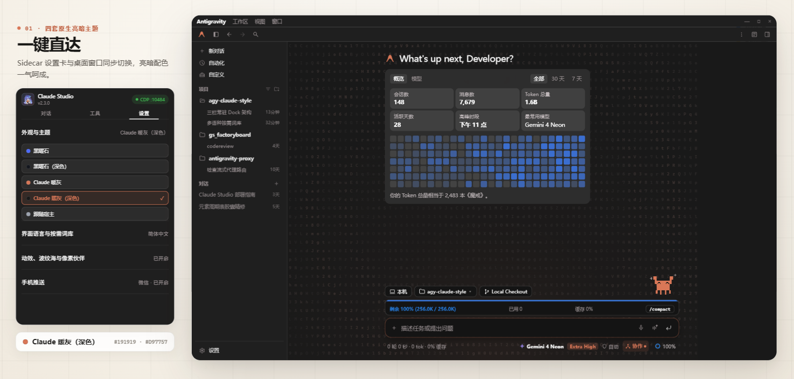

<br/>

#### 独立三栏常驻 Claude Studio 侧栏（打开内置浏览器预览、文件或终端时始终常驻最右、互不遮挡）
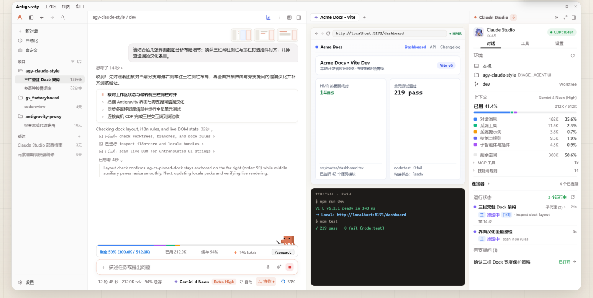

<br/>

#### 上下文全景掌控（低剩余红警提示 + `/btw` 旁支提问侧栏 + `/compact` 快捷预设）
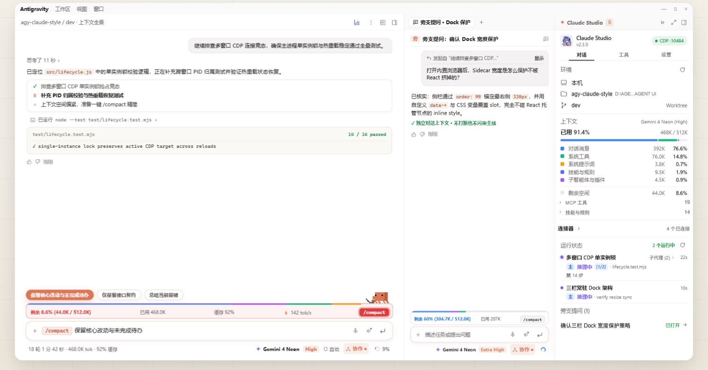

<br/>

#### 模型选择与思考强度打磨
<table>
  <tr>
    <td align="center" width="54%">
      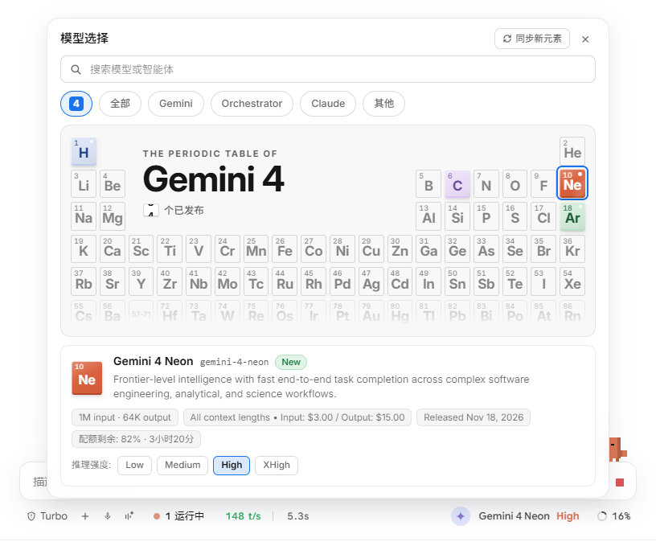<br/>
      <sub><b>Gemini 4 元素周期表模型选择器</b>（分类筛选、搜索、配额徽章与 AI Studio 直连同步）</sub>
    </td>
    <td align="center" width="46%">
      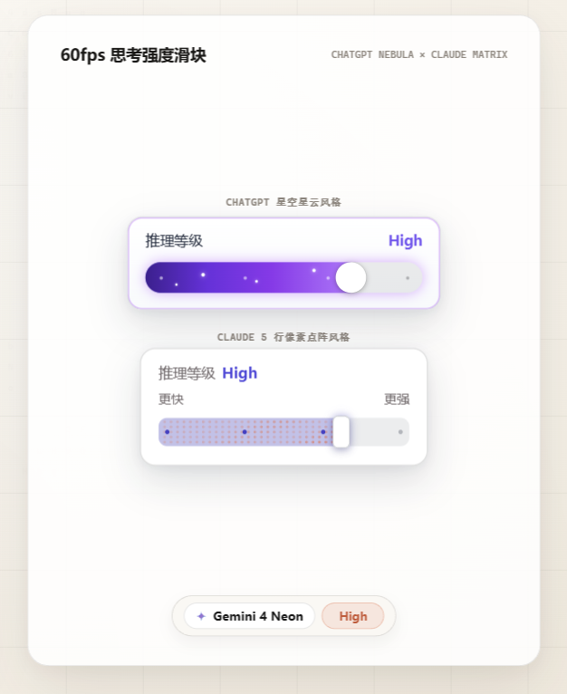<br/>
      <sub><b>双风格 60fps 思考强度滑块</b>（ChatGPT 星云 / Claude 5 行像素点阵，或切换 <code>off</code> 保留原生）</sub>
    </td>
  </tr>
</table>

<br/>

#### 效率三连：技能/市场按需一键翻译 · `⋮ → 插件` 顶栏钉选与 `✦` 收起 · 工作区快捷环境菜单
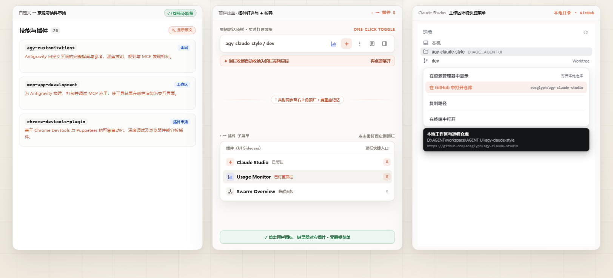

<br/>

#### Claude Studio 控制室 × Usage Monitor 搭档协同
<table>
  <tr>
    <td align="center" width="50%">
      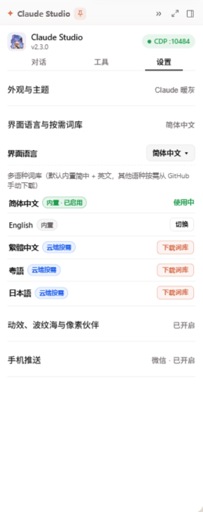<br/>
      <sub><b>Claude Studio 控制室</b>（紧凑单开手风琴设置、5 语种按需词库、测试版通道与顶栏原地升级）</sub>
    </td>
    <td align="center" width="50%">
      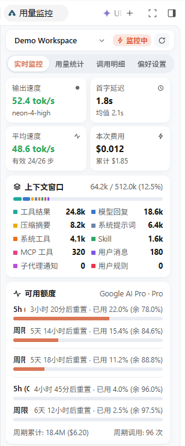<br/>
      <sub><b>Usage Monitor 搭档协同</b>（独立三栏互不遮挡，还可一键钉选至顶栏快速切换）</sub>
    </td>
  </tr>
</table>

</div>

---

<a id="核心特性"></a>
## 核心特性

简单聊聊 `Claude Studio` 给 Antigravity 加了哪些顺手的小功能——全部通过 CDP 在内存里动态注入，既不改动安装目录里的原文件，想退回原版也随时一键还原。

### 独立三栏常驻侧栏与 3-Tab 控制室（`对话 | 工具 | 设置`）
- **独立三栏常驻 Dock（`pinRightPane: 'studio' | 'off'`）**：将 Claude Studio 固定在窗口最右侧作为独立第三栏，打开内置浏览器预览、文件查看器、终端或其他辅助面板标签页时始终常驻最右、互不遮挡；未打开其他辅助标签页时也支持单栏独立常驻。
- **全屏看图零帧让位与 `0px` 折叠**：当辅助面板最大化（如全屏查看图片）时，常驻 Studio 侧栏与 iframe 零帧延迟自动让位，退出最大化后无缝恢复；手动收起侧栏后会折叠至 `0px`，并在对话顶栏 `⋮` 左侧保留一枚陶土红 `✦` 按钮随时一键展开。
- **「对话」页**：内置 **Claude 风格环境 / Worktree 快捷菜单**（支持 `.repo + worktree/` 容器仓库识别与暗色分支悬浮提示），直观展示当前工作区、Git 分支、外部工具及按类别拆解的上下文占用；底部实时活动条支持**活跃任务置顶与恢复**，并完整追踪 **`/btw` 旁支提问**（平静统一的空态/有项卡片、严格的多会话隔离与精简的 `旁` 角色徽章）。
- **「工具」页**：专门用于运行本机 Node / Python / Shell 脚本，内置带**自动中文翻译**的 Antigravity 官方更新日志抓取脚本（`scripts/fetch-agy-changelog.mjs`）；脚本运行结果会在对话区上方弹出**宽屏 Markdown 卡片**（仅本地渲染展示，不会发给模型），侧栏也保留可折叠日志，并集成手机推送快捷开关与状态卡片。
- **「设置」页**：采用更紧凑的**单开手风琴**分组，支持按需语言包管理与可选的**测试版更新通道**（`receivePrerelease`）；右上角自带**一键检查与原地升级**，升级时自动通过 SHA-256 白名单清理 `v2.2.4` 前的根目录遗留文件，同时完整保留个人配置与自定义脚本。

### 对话顶栏任意插件快捷钉选
- 在对话右上角 `⋮ → 插件` 子菜单中，每一行右侧都新增了 `📌` 钉选胶囊——点击即可钉选或取消钉选任意 UI 侧栏插件，**不会误触打开插件，也不会关闭菜单**。
- 已钉选的插件会以**原版图标**依次排列在对话顶栏 `⋮` 左侧，支持**三态点击切换**（未打开时点击打开 / 已打开其他插件时一键切过去 / 已处于当前插件时再次点击关闭收起）。
- 自动与折叠状态的 Claude Studio `✦` 按钮去重，避免重复图标占位。

### 5 套对称显式浅色与深色配色
- 提供 `claude`（Claude 暖灰浅色）、`claude-dark`（Claude 暖灰深色）、`obsidian`（黑曜石浅色）、`obsidian-dark`（黑曜石深色）与 `host`（跟随宿主）五项对称选择。
- 显式浅色与显式深色可**跨 Antigravity 宿主明暗模式独立生效**，完整覆盖全局界面变量、代码块语法高亮、图表色板、思考强度滑块、毛玻璃浮层与 Claude Studio 控制室侧栏，避免半亮半暗割裂感。

### 模型选择、思考强度、`/compact` 与 `/btw`
- **模型胶囊分组与 Gemini 4 元素周期表**：将 `✦` 图标与模型名称合为统一的悬浮/展开胶囊（并自动拦截原生模型菜单防止重叠），思考强度独立为等高胶囊；元素周期表支持分类筛选、关键词搜索、配额徽章以及直连 Google AI Studio 同步最新模型与配色。
- **协作模式（Orchestrator）快捷开关**：直接放在底栏模型胶囊旁，一键切换标准模式和协作模式；重启后记住你的选择，对话运行期间自动锁定防止误触。
- **双风格 60fps 思考强度滑块与原生隔离**：`effortSliderStyle` 支持 `chatgpt`（星云）、`claude`（5 行像素点阵）以及 `off`（保留原生思考强度控件，此时元素周期表收敛为仅由 `✦` 按钮进入）；关闭 `composerRestyle` 时彻底隔离原生输入框布局与毛玻璃影响。
- **`/compact` 5 套预设与 `/btw` 无感令牌切换**：在输入框触发 `/compact` 提供 5 套预设——**留空** `empty`、**精简降噪** `clean`【默认】、**开发交接** `dev`、**继续压缩** `continue`、**自定义** `custom`（仅填入输入框便于微调，不自动发送）；点击切换 `/compact` 与 `/btw` 时，可在 Lexical 输入框中原位无感替换斜杠令牌，完整保留普通草稿与中文输入法（IME）组合状态。

### Antigravity v2.36.0 本地化、技能与插件市场按需翻译
- **全面覆盖 Antigravity `v2.36.0`**：完整适配 `v2.36.0` 新增的旁支提问、新建标签页、设置页以及 `/swarm` 蜂群侧栏文案，并加入**过期云端词库保护**，避免旧版远端语言包覆盖新版内置词条。
- **精简按需语言包**：基础包仅内置**简体中文（`zh-CN`）**与**英文（`en`）**；**繁体中文（`zh-TW`）**、**粤语（`yue`）**与**日语（`ja`）**按需从云端下载并进行 SHA-256 校验，设置页清晰区分 `云端` 与 `云端已更新` 状态并提供绿色一键更新按钮。
- **技能页与插件市场按需翻译胶囊**：在**插件市场**以及**「设置 → 技能」 / `/customizations`** 页面均提供按需翻译小胶囊——平时零后台网络请求，点击即翻、再点切回原文，自动保留代码标识符，并严格遵守 `translate="no"`、`.notranslate`、云端保护名单和自定义 `i18nIgnoreSelectors` 规则。

### 对话区文件链接右键菜单
聊天时 AI 贴出来的本地文件链接或者文件提及胶囊，直接右键即可操作：
- **打开文件**：用系统默认应用打开（只对安全的文档、代码和媒体文件放行）。
- **在文件夹中显示**：Windows 下优先直接调原生资源管理器（`explorer.exe /select`）快速选中文件，遇到带逗号等特殊路径也会通过专有助手稳妥兜底；macOS 下则在 Finder 里高亮定位。
- **复制完整路径**：一键把完整路径放进剪贴板。

不需要的话，在设置里把 `fileLinkContextMenu` 关掉就行。

### 手机推送提醒
有时候让 AI 跑个长重构或者批量任务，人走开倒杯水，任务跑完或报错了可以直接由本地发条消息到手机：
- **支持 8 种渠道**：Server酱（支持约 28KB 完整 Markdown 正文）、Bark（iOS）、ntfy、飞书、钉钉、企业微信、Telegram Bot 和自定义 Webhook。
- **不会乱发消息**：默认跑满 3 分钟以上的任务才推（几秒钟的短问答不打扰），出错立刻提醒，手动点取消的话也会保持安静。
- 密钥和 Webhook 地址只保存在本机的 `PLUGIN_DATA/notify.json` 里，不会写进 `config.json`，也不会注入到页面中。

### 界面微调、加载动效与小螃蟹 Clawd
- **细节与动效**：可自由搭配独立毛玻璃浮层、左上角 Logo 着色、中文输入法友好的丝滑打字光标，以及带交互水波纹与用量热力图的 Studio 首页。
- **加载动效（Gemini发现了新玩具）**（`geminiLoader`）：在「设置 → 界面微调」里打开后，可以把原生加载转圈换成可爱的 Gemini 娘和头顶的 12 刻度环。
- **像素小螃蟹 Clawd**：蹲在输入框边上的小跟班，会随 AI 的思考、输出、报错或完成状态切换动作。平时可以轻戳让它扭头、连点 4 下挠痒、按住拎起来晃两下，闲着没事还会打盹；问答卡片或排队栏弹出来时它也会自己挪开让路。

### 4 项内置技能
装好插件后，直接在对话框里就能呼唤这 4 个小向导：
- **`studio-setup`**：花 30 秒带你过一遍基础偏好设置。
- **`studio-doctor`**：帮你检查 CDP 连接、权限和后台进程，顺手修掉常见小毛病。
- **`studio-notify`**：一步步带你配好手机推送并测试发送。
- **`studio-translation-protect`**：帮你把不想被翻译的界面元素加进忽略名单。

---

<a id="推荐搭档"></a>
## 推荐搭档：`antigravity-usage-monitor`

`Claude Studio` 专注**视觉美学、多栏工作区打磨、会话实时检视与本地化**；如需实时速率（`tok/s`）、首字延迟（TTFT）、费用核算与多模型配额池，推荐搭配独立开源插件 **[yuhuan-dev/antigravity-usage-monitor](https://github.com/yuhuan-dev/antigravity-usage-monitor)**：

- **独立三栏并行 + 顶栏一键钉选**：在 `v2.3.0` 中，Claude Studio 常驻于窗口最右侧的独立第三栏（`pinRightPane: 'studio' | 'off'`），与运行在辅助面板（Aux Pane）中的 `usage-monitor` **左右并排、互不抢占**；同时你可以在 `⋮ → 插件` 菜单里点一下 `Usage Monitor` 旁的 `📌`，将它钉选到对话顶栏，实现一键三态快速展开、切换与收起。
- **零冲突共存**：内置轻量 HUD 默认仅开启顶部精简条（`usageStatsEnabled: true`、`hudTopBar: true`、`hudBottomBar: false`、`hudRimProgress: false`），搭配外部用量监控时可随时在设置中一键关闭内置用量模块；翻译引擎通过内置保护名单永久避让 `#ag-usage-monitor-*` 节点，两者互不打扰。
- **底栏智能拆分**：当 `usage-monitor` 停靠在输入框底栏时，自动将其上下文进度环镜像至最右侧，避免两个组件互相挤压或引起界面抖动。
- **协议边界清晰**：本项目遵循宽松的 MIT 协议，`antigravity-usage-monitor` 遵循 GPLv3 协议，两者严格解耦、各自独立安装。

---

<a id="快速安装"></a>
## 快速安装

### 环境要求
- **Google Antigravity Desktop `2.33.1+`**（全面适配 `2.36.x`，支持 Windows / macOS），启动时需开启 CDP 参数 `--remote-debugging-port=0`。
- **Node.js `>= 22`**（纯原生代码，零第三方 npm 依赖，仅使用内置 `fetch`、`WebSocket` 与 `node:test`）。

### 最省心方式：直接发给 Antigravity 里的 Gemini（推荐）

不用自己敲命令，直接在 Antigravity 对话框里发给 Gemini 即可：

**首次安装**：
> **帮我安装这个 Antigravity 插件：`https://github.com/eosglyph/agy-claude-studio`**

**旧版本升级与迁移**（如果本机此前已安装旧版或发过指定升级指令，直接发这句）：
> **请按 GitHub 仓库 `https://github.com/eosglyph/agy-claude-studio` 的 README.zh-CN.md（升级与旧版迁移核对清单）和最新 Release 说明，帮我把本机 Claude Studio 升级/迁移到最新版**

> **可选 · 截图同款三栏协同体验**：想一步到位配齐「用量监控」搭档插件（独立开源，GPLv3），直接发：
>
> **帮我安装 `https://github.com/eosglyph/agy-claude-studio` 以及推荐搭档 `https://github.com/yuhuan-dev/antigravity-usage-monitor`**

安装启用后，还可以直接对 Gemini 说：
- *「带我 30 秒完成 Claude Studio 初始偏好配置」*（唤起 `studio-setup` 技能）
- *「帮我配置任务完成时的手机微信/iOS 推送提醒」*（唤起 `studio-notify` 技能）
- *「帮我诊断 Claude Studio 运行状态」*（唤起 `studio-doctor` 技能）

### 升级与旧版迁移核对清单

无论是升级更新还是由 AI 助手协助从旧版 `v2.1` / `v2.2` / `agy-claude-style` 迁移，请按以下要点核对：

1. **保留本地个人数据与自动迁移**：
   升级时完整保留 `~/.gemini/antigravity/plugin_data/agy-claude-studio/` 下的所有个人数据，包括 `config.json`（偏好设置）、`notify.json`（手机推送凭据）、`notify-state.json`（通知状态）、`scripts.json`（自定义脚本列表）、`i18n-packs/`（按需语言包缓存）以及 `scripts/ops/` 中的自定义脚本；`v2.3.0` 升级至 `configSchemaVersion: 2` 后会自动启用常驻 Studio 侧栏，并通过 SHA-256 白名单自动清理 `v2.2.4` 之前遗留在插件根目录的旧文件（保留用户自定义修改）。首次从更早版本迁移时，也会自动将遗留的 `plugin_data/agy-claude-style/config.json` 平滑迁移至新目录。
2. **旧版后台守护与残留排查（Windows 环境）**：
   - Windows 用户直接运行最新版 `.exe` 安装器即可自动完成旧版检测、遗留守护清理与平滑迁移。
   - 若手动升级或由 AI 助手协助迁移：请注意，仅更新插件目录源码**不会**自动关闭旧目录（如 `%LOCALAPPDATA%\agy-claude-style`）中仍在运行的遗留守护进程 `agy-claude-style-watcher.exe`。
   - 升级前请先执行只读检查，确认后台是否存在 `agy-claude-style-watcher` 进程或旧版开机自启/卸载项。若存在，请在**征得用户确认后**通过旧版卸载入口关闭自启并确保旧进程彻底退出，再启用新版 `Claude Studio`（新版已深度接入宿主生命周期，在插件管理中关闭开关即可自动停注还原，不留孤儿进程）。
3. **启用与快速生效**：
   若 Antigravity 已携带 `--remote-debugging-port=0` 运行，可直接点击右侧控制室顶栏「升级」，或在插件目录下执行 `npm run inject`（或 `node src/inject.js`）热刷新（**切勿未经用户确认强杀正在运行的 Antigravity 进程**）；完成后可运行 `studio-doctor` 技能进行环境自检。

### 方式一：Windows 一键原生插件安装器（推荐 Windows 用户）

<div align="center">
  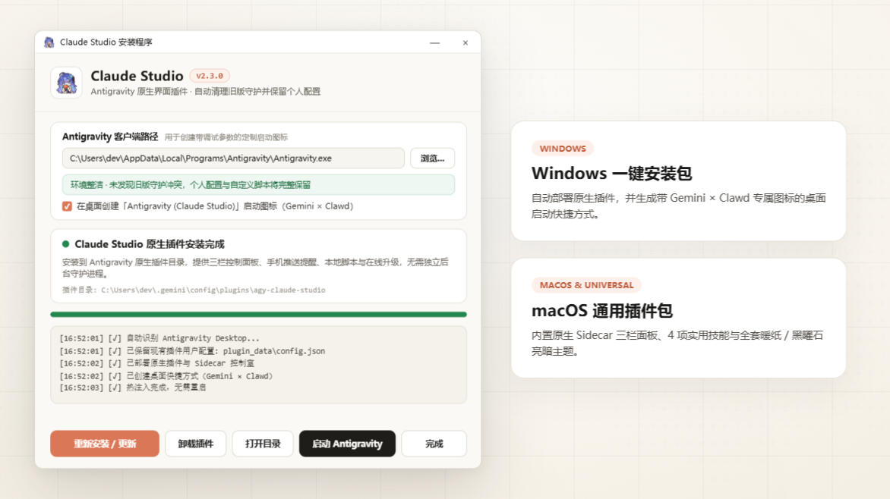
</div>

直接在 [GitHub Releases](https://github.com/eosglyph/agy-claude-studio/releases) 下载 `Claude-Studio-v<version>-Windows-x64.exe`：
- 全新 **Claude 暖白界面**，双击运行即可自动检测并清理旧版 `v2.1.0 / v2.2.x` 遗留守护进程与 `v2.2.4` 前根目录旧文件，完整保留并迁移 `plugin_data/` 配置和自定义脚本。
- 将完整原生插件释放至 `%USERPROFILE%\.gemini\config\plugins\agy-claude-studio` 并在宿主配置中自动启用。
- 自动生成并持久化带有 **Gemini × Clawd 定制图标** 的桌面与开始菜单快捷方式（直连带 `--remote-debugging-port=0` 的 Antigravity）。
- 支持在 Windows「设置 → 应用」中一键干净卸载还原。

### 方式二：通用插件包（macOS / Linux / 离线安装）

在 Releases 中下载跨平台通用插件包 `Claude-Studio-v<version>-plugin.zip`（不再随 Release 预构建 `.dmg` 镜像）：
- 解压到 `~/.gemini/config/plugins/`（形成 `~/.gemini/config/plugins/agy-claude-studio` 目录）。
- 携带 `--remote-debugging-port=0` 重新启动 Antigravity，并在 **Customizations → Plugins** 中确认启用即可。
> **平台说明**：维护者目前没有 Mac 真机测试环境，macOS 与 Linux 用户推荐直接使用通用插件包或发给 Antigravity 里的 Gemini 自动安装，非常欢迎真机环境下的反馈与 PR！

<details>
<summary><b>方式三：Antigravity 原生插件模式（手动 Git 克隆）</b></summary>

1. 将仓库克隆到 Antigravity 插件目录：
   ```powershell
   # Windows (PowerShell)
   git clone https://github.com/eosglyph/agy-claude-studio.git "$env:USERPROFILE\.gemini\config\plugins\agy-claude-studio"
   ```
   ```bash
   # macOS / Linux
   git clone https://github.com/eosglyph/agy-claude-studio.git "$HOME/.gemini/config/plugins/agy-claude-studio"
   ```
2. 彻底退出 Antigravity（含系统托盘），以 `--remote-debugging-port=0` 重新启动（或直接运行 `npm run launch` / `node src/inject.js --launch`）。
3. 在 Antigravity **Customizations → Plugins** 中确认 **`Claude Studio`** 已启用，即可自动注入并在窗口右侧展开 **Claude Studio** 控制室。

</details>

<details>
<summary><b>本地构建 Windows 原生安装器 / 伴随启动包</b></summary>

- **构建 Windows 原生插件安装器与通用插件包**：
  ```bash
  npm run build:installer
  # 或同时生成跨平台 plugin.zip
  node scripts/build-installer.mjs --plugin-zip dist/Claude-Studio-plugin.zip
  ```

- **Windows 伴随启动包（含 Gemini × Clawd 定制图标）**：
  ```powershell
  npm run build:release
  powershell -NoProfile -ExecutionPolicy Bypass -File .\companion\setup-companion.ps1
  ```
  若本机已启用原生插件，伴随启动脚本会自动退让，仅负责以 `--remote-debugging-port=0` 和定制图标启动 Antigravity。

</details>

<details>
<summary><b>Node.js CLI 尝鲜 / 本地开发模式</b></summary>

```bash
cp config.example.json config.json   # 可选，默认使用内置配置
npm run inject                        # 单次注入当前窗口
npm run watch                         # 后台热更新守护（修改代码/配置自动生效）
npm run remove                        # 停止守护并无损还原原生界面
```

</details>

---

## 小螃蟹 Clawd 互动速览

<div align="center">
  
</div>

| 互动 | 操作方式 | 表现 |
| --- | --- | --- |
| 轻戳 | 单击左侧或右侧身体 | 害羞扭头反馈（`poke-left` / `poke-right`） |
| 挠痒 | `450ms` 内连点 4 下 | 爆笑踢腿（`tickle`） |
| 拎起 | 按住鼠标左键拖拽 | 悬空挣扎，松手落地（`drag`） |
| 小憩 | 界面安静 60 秒以上 | 自动打盹（`sleeping`），点击或发消息伸懒腰唤醒（`waking`） |
| 状态跟随 | AI 思考 / 输出 / 报错 / 完成 | 自动切换对应动作，并在问答卡片或排队栏出现时主动避让 |

---

<a id="配置参考"></a>
## 配置参考

所有选项均可在右侧 **Claude Studio** 面板实时调整并自动保存（完整模板见 [config.example.json](config.example.json)）。手机推送配置与凭据单独隔离保存在本机 `PLUGIN_DATA/notify.json` 中，不会写入 `config.json` 也不会注入渲染进程。

<details>
<summary><b>展开查看全部配置项说明</b></summary>

| 分组 | 配置键 | 可选值 / 类型 | 默认值 | 说明 |
| --- | --- | --- | --- | --- |
| 基础设置 | `language` | `'zh-CN'` \| `'zh-TW'` \| `'yue'` \| `'en'` \| `'ja'` | `'zh-CN'` | 界面与控制面板语言（`zh-CN` 与 `en` 内置，`zh-TW` / `yue` / `ja` 按需拉取） |
| 基础设置 | `homeLayout` | `'studio'` \| `'classic'` \| `'off'` | `'studio'` | 新会话首页布局 |
| 基础设置 | `palette` | `'claude'` \| `'claude-dark'` \| `'obsidian'` \| `'obsidian-dark'` \| `'host'` | `'claude'` | 5 套对称显式浅色/深色主题配色（跨宿主明暗生效），或 `'host'` 跟随宿主原生外观 |
| 界面微调 | `glassEffect` | `boolean` | `true` | 独立毛玻璃质感与失焦柔和环境光 |
| 界面微调 | `sidebarRestyle` / `sidebarCompact` | `boolean` | `true` | 侧边栏重塑与紧凑间距 |
| 界面微调 | `composerRestyle` / `placeholderStyle` | `boolean` / `'studio'` \| `'host'` | `true` / `'studio'` | 极简输入框与引导文案风格（关闭 `composerRestyle` 时完全隔离原生布局） |
| 界面微调 | `logoInk` | `'accent'` \| `'foreground'` | `'accent'` | 首页及左上角应用 Logo 着色模式 |
| 界面微调 | `geminiLoader` | `boolean` | `true` | 加载动效：用可爱的 Gemini 娘和 12 刻度环替换原生转圈 |
| 进阶交互 | `fileLinkContextMenu` | `boolean` | `true` | 对话文件右键菜单：右击本地文件链接唤起打开/定位/复制路径菜单 |
| 进阶交互 | `periodicSelector` / `orchestratorSwitch` | `boolean` | `true` | Gemini 4 元素周期表选择器与协作模式快捷开关 |
| 进阶交互 | `effortSliderStyle` / `effortAccent` | `'chatgpt'` \| `'claude'` \| `'off'` / `boolean` | `'chatgpt'` / `true` | 思考强度滑块风格（`'off'` 保留原生控件）与色阶 |
| 进阶交互 | `compactPreset` / `compactCustomText` | `'empty'` \| `'clean'` \| `'dev'` \| `'continue'` \| `'custom'` / `string` | `'clean'` / `''` | `/compact` 压缩预设（含 `continue` 继续压缩）与自定义指令文案 |
| 进阶交互 | `smoothCaret` / `mascot` / `homeRipple` | `boolean` / `'crab'` \| `'off'` / `boolean` | `true` / `'crab'` / `true` | 丝滑光标、Clawd 挂件、首页字符水波纹 |
| 翻译保护 | `pluginPageTranslate` / `i18nIgnoreSelectors` | `boolean` / `string[]` | `true` / `[]` | 插件市场及技能页按需翻译小胶囊与自定义免翻译 CSS 选择器 |
| 侧栏与顶栏 | `pinRightPane` | `'studio'` \| `'off'` | `'studio'` | 独立三栏常驻 Claude Studio 侧栏开关 |
| 侧栏与顶栏 | `pinnedToolbarPlugins` | `string[]` | `[]` | 钉选至对话顶栏 `⋮` 左侧的 UI 侧栏插件 ID 列表（最多 12 项，通过 `⋮ → 插件` 的 `📌` 按钮管理） |
| 用量统计 | `usageStatsEnabled` | `boolean` | `true` | 内置用量统计总开关（关闭时不覆盖子项偏好） |
| 用量统计 | `inlineStats` / `ringMode` / `turnBadges` | `boolean` / `'context'` \| `'quota'` / `boolean` | `true` / `'context'` / `true` | *(总开关开启后生效)* 内置底栏统计、圆环与轮次徽章 |
| 用量统计 | `hudTopBar` / `hudBottomBar` / `hudRimProgress` | `boolean` | `true` / `false` / `false` | *(总开关开启后生效)* 顶部 HUD、底部统计条与环绕进度条 |
| 更新与运行时 | `receivePrerelease` | `boolean` | `false` | 是否接收测试版本（prerelease）更新推送 |
| 更新与运行时 | `autoRelaunchWithCdp` / `exitOnHostClose` / `pollIntervalMs` | `boolean` / `boolean` / `number` | `true` / `false` / `2500` | CDP 自动接管、宿主关闭随同退出与轮询间隔 |

</details>

---

<a id="常见问题"></a>
## 常见问题

<details>
<summary><b>1. 升级到 Antigravity 2.33.0+ 后没有自动注入？</b></summary>

Antigravity 从 `2.33.0` 起默认不再开启 CDP 端口。请彻底退出 Antigravity（含系统托盘）后携带 `--remote-debugging-port=0` 启动，或直接使用右侧面板的一键重启 / `npm run launch`（`node src/inject.js --launch`）；也可以直接对 Gemini 说 *「帮我诊断 Claude Studio」* 触发 `studio-doctor` 技能排查。

</details>

<details>
<summary><b>2. 如何搭配 Usage Monitor 等第三方侧栏插件一起使用？</b></summary>

从 `v2.3.0` 起，Claude Studio 采用窗口最右侧的**独立三栏常驻侧栏**（`pinRightPane: 'studio'`），不再占用原生辅助面板（Aux Pane）槽位，因此可以直接与 [yuhuan-dev/antigravity-usage-monitor](https://github.com/yuhuan-dev/antigravity-usage-monitor) 或浏览器预览、文件、终端并排共存。点击对话右上角 `⋮ → 插件`，在 `Usage Monitor`（或任意 UI 侧栏插件）右侧点击 `📌` 即可将其图标钉选到对话顶栏，实现一键打开、切换与收起；如果不安装额外插件，保持 `pinRightPane: 'studio'` 搭配内置轻量用量统计即可开箱使用。

</details>

<details>
<summary><b>3. 为什么侧边栏会话列表的右键菜单仍是英文？</b></summary>

侧边栏右键菜单由 Electron 调用操作系统原生菜单（Win32 / NSMenu）绘制，不在网页 DOM 树中，纯无损 CDP 注入无法改写系统原生菜单文案；应用内所有 DOM 界面、设置页与浮窗均已支持 5 语言本地化。

</details>

<details>
<summary><b>4. 如何彻底还原原生界面？</b></summary>

点击右侧 **Claude Studio** 面板的 **「还原原生」**，或在 Antigravity 插件管理中禁用 `Claude Studio` / 运行 `npm run remove`，即可无痕恢复原版，绝不修改任何宿主文件。

</details>

<details>
<summary><b>5. Windows 非 TUN / 进程级代理环境使用提示</b></summary>

如果你在 Windows 下未开启系统全局代理或 TUN 模式，而是通过本地代理启动脚本为 Antigravity 注入进程级代理变量，可以按以下方式配置：

1. **首次启动快捷方式**：将桌面或开始菜单中的 `Antigravity (Claude Studio).lnk` 指向你的进程级代理启动脚本（需支持 `%*` 参数透传），并在快捷方式参数中附带 `--remote-debugging-port=0`。
2. **推荐环境变量**（以本地代理端口 `127.0.0.1:7890` 为例）：
   ```bat
   set HTTP_PROXY=http://127.0.0.1:7890
   set HTTPS_PROXY=http://127.0.0.1:7890
   set NODE_USE_ENV_PROXY=1
   set NO_PROXY=localhost,127.0.0.1,::1
   ```
   - `NODE_USE_ENV_PROXY=1` 可让 Node.js 22+ 原生 `fetch` 自动走代理，确保右侧面板的**检查更新**、**Gemini 4 元素周期表同步**与**按需语言包下载**正常联网；
   - `NO_PROXY=localhost,127.0.0.1,::1` 确保本地 CDP 调试端口与 `language_server` 回环通信保持直连，不被代理截断；
   - 如需 SOCKS5 代理，可按需一并设置 `ALL_PROXY`。
3. **侧栏重启自动保留代理**：从右侧 **Claude Studio** 面板触发重启时，插件会自动提取当前进程中的 `HTTP_PROXY`、`HTTPS_PROXY`、`ALL_PROXY`、`NO_PROXY`、`NODE_USE_ENV_PROXY` 并安全透传给重启后的 `Antigravity.exe` 进程，同时在临时启动脚本退出后自动清理。未使用进程级代理（TUN 模式或直连）的用户不受任何影响。

</details>

---

## 开发与测试

```bash
npm test                 # 运行全部单元测试（Node.js >= 22，零依赖）
npm run build:installer  # 构建 Windows 单文件安装器
npm run build:release    # 打包 Windows 伴随启动发布包
npm run build:macos      # 构建 macOS Universal .app 与 .dmg（需 macOS 环境）
```

<details>
<summary><b>查看项目目录结构</b></summary>

```text
agy-claude-studio/
├── plugin.json / mcp_config.json / hooks.json  # 原生插件清单、轻量宿主与 Stop Hook
├── plugin/mcp-host.js                          # 原生插件生命周期宿主（PID 复用校验与热接管）
├── sidecars/studio/                            # 独立三栏 3-Tab「Claude Studio」控制室（对话 / 工具 / 设置）
├── skills/                                     # 4 项原生技能（setup / doctor / notify / translation-protect）
├── src/                                        # 核心运行时、CDP 生命周期、UI 模块与本地化引擎
│   ├── cdp.js / lifecycle.js                   # CDP 客户端、配置迁移、进程守护与宿主看门狗
│   ├── watcher-core.js / inject.js / remove.js # 多窗口热更新控制器与 CLI 注入/还原入口
│   ├── style.css / ui-runtime.js               # 核心主题样式与运行时（首页、三栏 Dock、顶栏钉选、周期表、滑块、/compact）
│   ├── sidecar-core.js                         # Swarm 蜂群侧栏（/swarm）精简无损翻译运行时
│   ├── periodic-core.js / periodic-sync.js     # Gemini 4 元素周期表目录与 AI Studio 直连同步
│   ├── effort-core.js                          # 双风格 60fps 思考强度滑块数学模型
│   ├── notify-core.js / scripts-core.js        # 8 渠道手机推送核心与本地脚本工具箱
│   ├── i18n-core.js / i18n-locales.js / i18n-sync.js # 本地化引擎、内置语言词典与按需语言包同步器
│   ├── usage-core.js                           # 内置轨迹解析、上下文拆解与热力图引擎
│   ├── mascot-core.js / crab-assets.js         # Clawd 状态机与 19 套像素双层精灵图
│   └── ripple-core.js                          # 首页字符矩阵噪声与二维水波求解器
├── locales/                                    # 按需语言包离线词典
├── i18n-compat.json                            # 第三方搭档插件免打扰翻译保护名单
├── installer/ & companion/                     # Windows (C#) / macOS (Swift) 安装器与伴随脚本
├── scripts/                                    # Stop Hook、更新日志抓取、Windows 助手与构建脚本
│   ├── notify-stop.mjs / fetch-agy-changelog.mjs # Stop Hook 入口与 Antigravity 更新日志抓取与翻译
│   ├── WindowsFileAction.cs                    # Windows 原生资源管理器文件选中定位与路径动作
│   └── build-*.mjs                             # 安装器、macOS、语言包与发布包构建脚本
├── test/                                       # node:test 自动化测试套件
└── assets/                                     # 图标、横幅与实景展示图
```

</details>

---

<a id="致谢与开源协议"></a>
## 致谢与开源协议

本项目基于 [MIT License](LICENSE) 开源，衷心感谢以下开源项目与社区贡献者：

- **上游原版仓库**：[0DNANCY/agy-claude-style](https://github.com/0DNANCY/agy-claude-style)（MIT License）
- **核心设计灵感与早期源码**：[Nwflower/dsh-claude-style](https://github.com/Nwflower/dsh-claude-style)
- **macOS 守护内存池与 CDP 连接复用参考**：[SeredenFei/agy-claude-style](https://github.com/SeredenFei/agy-claude-style)
- **原生插件托管、右侧辅助栏与 2.33.1 适配参考**：[Gruu6y/agy-claude-style](https://github.com/Gruu6y/agy-claude-style)
- **毛玻璃与看图悬浮胶囊设计灵感**：[MCRYII/antigravity-custom-themes](https://github.com/MCRYII/antigravity-custom-themes)
- **Codex 思考强度滑杆样式**：[Microqian2th/dsh-codex-effort-slider](https://github.com/Microqian2th/dsh-codex-effort-slider)
- **推荐搭档用量监控插件（GPLv3，独立解耦安装）**：[yuhuan-dev/antigravity-usage-monitor](https://github.com/yuhuan-dev/antigravity-usage-monitor)
- **社区 PR 贡献**：感谢 [@fexpopopoi](https://github.com/fexpopopoi) 贡献 Windows 进程级代理环境变量透传支持（PR #4）
